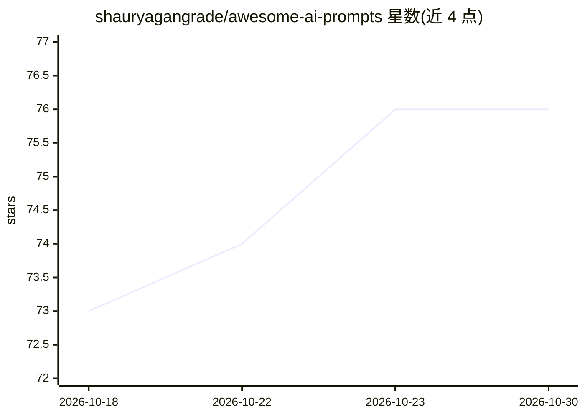

# shauryagangrade/awesome-ai-prompts

⭐ 76 · HTML · MIT · 推送 2026-10-25 · [GitHub](https://github.com/shauryagangrade/awesome-ai-prompts) · [官网](https://awesome-ai-prompts.vercel.app) · 个人维护

**面向 AI 编码代理的可复制提示词策展清单**

策展型的 AI 提示词列表：收录供开发者复制粘贴到 Claude、ChatGPT、Copilot、Cursor、opencode 等编码代理中的提示词文件，每条为单文件 Markdown，强调先读代码、小步确认、以测试与命令输出为验证的工作流。提供按类别组织的目录、单页目录网站（website/index.html 及每条提示词独立页面）、多语言翻译目录（i18n/）与贡献流程（含本地校验脚本与 CI 门禁）。使用方式为 git clone 后浏览并复制粘贴，无安装包或运行时依赖。

## 筛选速览

| 维度 | 判定 | 备注 |
|---|---|---|
| AI 角色 | `ai-knowledge` | 知识聚合/清单类 |
| 许可风险 | `permissive` | MIT |
| 部署形态 | `library` | 以包/库形式分发 |
| 模型依赖 | — | README 未给出锁定关系 |
| 硬件要求 | — | 无带数字的原话,不猜 |
| 安装摩擦 | `low` | 无编译、无系统依赖或容器化 |
| 成熟度 | — | 结构信号不足 |

## 能力要点

- 提示词与厂商无关，可用于 Claude/ChatGPT/Copilot/Cursor/opencode 等任意代理
- 两种格式：单页快捷提示与带硬约束和验证要求的 [spec] 提示
- 提供单页目录网站与 llms.txt 索引，脚本 build-all.py 可重新生成
- 贡献流程配备本地校验脚本（链接/一致性/markdownlint/em-dash 检查）与 CI 门禁

## 适用场景

- 复制现成提示词让编码代理按验证优先流程实现功能或修 bug
- 为高风险大型任务选用带硬约束的 spec 提示
- 用仓库自带的四个贡献提示词，让代理自动完成从 issue 到可合并 PR 的流程

## 场景标签

`提示工程` `精选清单` · 领域:Agent 开发

## 证据(README 行号)

> L7: A curated list of copy-paste AI prompts for **any developer who uses AI coding
> L34: - **Tool-agnostic** - works with Claude, ChatGPT, Copilot, Cursor, opencode,

## 星数曲线

2026-10-18 73 → 2026-10-30 76（+3）

---
*卡片 v1 · prompt 1.4 · 生成 2026-10-24 · 置信度 mid · 依据 README sha `376d09851673` · [字段定义](../../DATASET.md)*
