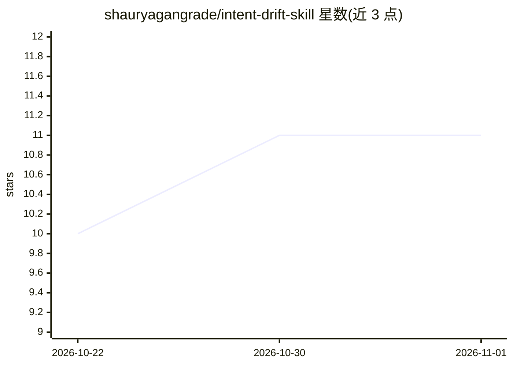

# shauryagangrade/intent-drift-skill

⭐ 11 · Python · Apache-2.0 · 推送 2026-10-21 · [GitHub](https://github.com/shauryagangrade/intent-drift-skill) · [官网](https://intent-drift.vercel.app) · 个人维护

**检测 AI 编程助手是否偏离原始意图的对齐分析技能**

面向 AI 辅助开发场景的 CLI 工具与 Claude 技能：将原始目标与当前执行计划、git diff、文件变更等仓库真实状态对比，由 Intent Alignment Engine 计算对齐分并生成可导出报告（文本/markdown/json）。每个评分可追溯到人工可核验的证据行；默认自动清除疑似密钥内容，shell 历史仅显式开启。支持 9 类证据提供方、可插拔自定义提供方与导出格式、跨会话历史时间线。产出一个暂停确认提示而非自主决策。

## 筛选速览

| 维度 | 判定 | 备注 |
|---|---|---|
| AI 角色 | `ai-ecosystem` | LLM/agent 周边工具 |
| 许可风险 | `permissive` | Apache-2.0 |
| 部署形态 | `library` | 以包/库形式分发 |
| 模型依赖 | — | README 未给出锁定关系 |
| 硬件要求 | — | 无带数字的原话,不猜 |
| 安装摩擦 | `low` | 无编译、无系统依赖或容器化 |
| 成熟度 | — | 结构信号不足 |

## 能力要点

- 基于 git diff、文件变更、提交趋势等 9 类证据提供方计算对齐分
- 评分可追溯到人工可核验的证据行
- 报告可导出为文本/markdown/json，含跨会话历史时间线
- 默认清除疑似密钥内容，shell 历史需显式开启

## 适用场景

- 长会话 AI 编程中检查 agent 是否偏离最初设定的目标
- 审查 AI 生成代码变更与原始需求的一致性
- 按时间线跟踪项目执行方向的对齐趋势

## 场景标签

 · 领域:开发者工具/AI 辅助开发

## 证据(README 行号)

> L21: Detects when AI coding agents begin solving a different problem than originally requested by monitoring alignment b
> L42: - Evidence-based drift detection using multiple providers

## 星数曲线

2026-10-22 10 → 2026-11-01 11（+1）

---
*卡片 v1 · prompt 1.4 · 生成 2026-11-01 · 置信度 high · 依据 README sha `2952906b263b` · [字段定义](../../DATASET.md)*
