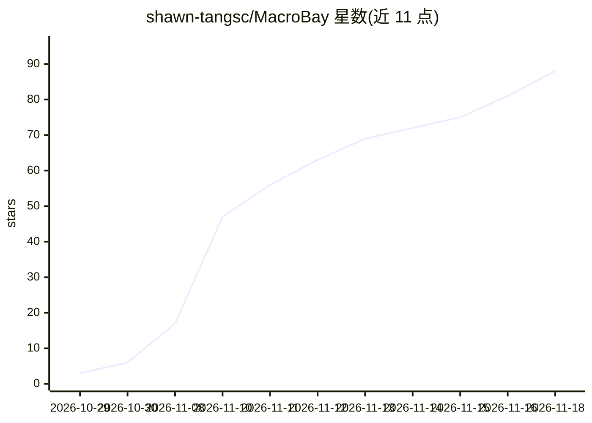

# shawn-tangsc/MacroBay

⭐ 88 · TypeScript · MIT · 推送 2026-11-11 · [GitHub](https://github.com/shawn-tangsc/MacroBay) · 个人维护 · 中文 README

**带 AI 分析师的加密货币市场情报桌面工作台**

面向加密货币交易者与学习者的 Electron 桌面应用（macOS 已验证、Windows 未验证、Linux 无打包）：单屏聚合永续资金费率、稳定币供应、ETF 流向、跨资产走势与宏观日历等面板，数据源由用户自行启用并配凭证，本地存储不依赖托管账号。AI 分析师读取同一份冻结快照证据作解读，每个数字附带来源记录与读取截止时间，无法采集的内容以缺口形式报告而非填充。回答结构化为事实/假设/条件/缺口/时间边界五要素。提供 .dmg/.exe 安装包（未签名）及 pnpm 源码运行方式，需用户自配模型服务商与 API key。

## 筛选速览

| 维度 | 判定 | 备注 |
|---|---|---|
| AI 角色 | `ai-enhanced` | 去掉 AI 部分产品仍成立 |
| 许可风险 | `permissive` | MIT |
| 部署形态 | `desktop` | 安装包/桌面程序 |
| 模型依赖 | — | README 未给出锁定关系 |
| 硬件要求 | — | 无带数字的原话,不猜 |
| 安装摩擦 | `low` | 无编译、无系统依赖或容器化 |
| 成熟度 | `idea` | |

## 能力要点

- AI 分析师基于本地冻结快照分析，结论区分事实/假设/条件/缺口/时间边界
- 每个数字携带来源记录与截止时间，未采集数据报告为缺口
- 本地优先：无捆绑数据、无捆绑 API key、无托管账号
- 聚合资金费率、稳定币、ETF 流向、跨资产与宏观数据源（Binance/CoinGecko/DeFiLlama/FRED 等）

## 适用场景

- 每早晨读一页市场简报，核验每个数字的来源与截止时间
- 用 AI 分析师追问宏观发布后哪些资产受影响及其证据链
- 在单屏内跟踪资金费率、稳定币供应与 ETF 流向等市场驱动因素

## 场景标签

`金融量化` `数据分析` · 领域:效率与自动化

## 证据(README 行号)

> L26: and the macro prints that reprice everything. The analyst agent reads the same evidence and explains
> L125: - **An analyst with a visible trace.** It reads the same evidence, separates facts from assumptions,
> L196: 1. **Settings → Model Service**: add a provider and API key, enable it, and choose the default model

## 星数曲线

2026-10-29 3 → 2026-11-18 88（+85）

---
*卡片 v1 · prompt 1.4 · 生成 2026-11-18 · 置信度 mid · 依据 README sha `f4896eb44380` · [字段定义](../../DATASET.md)*
