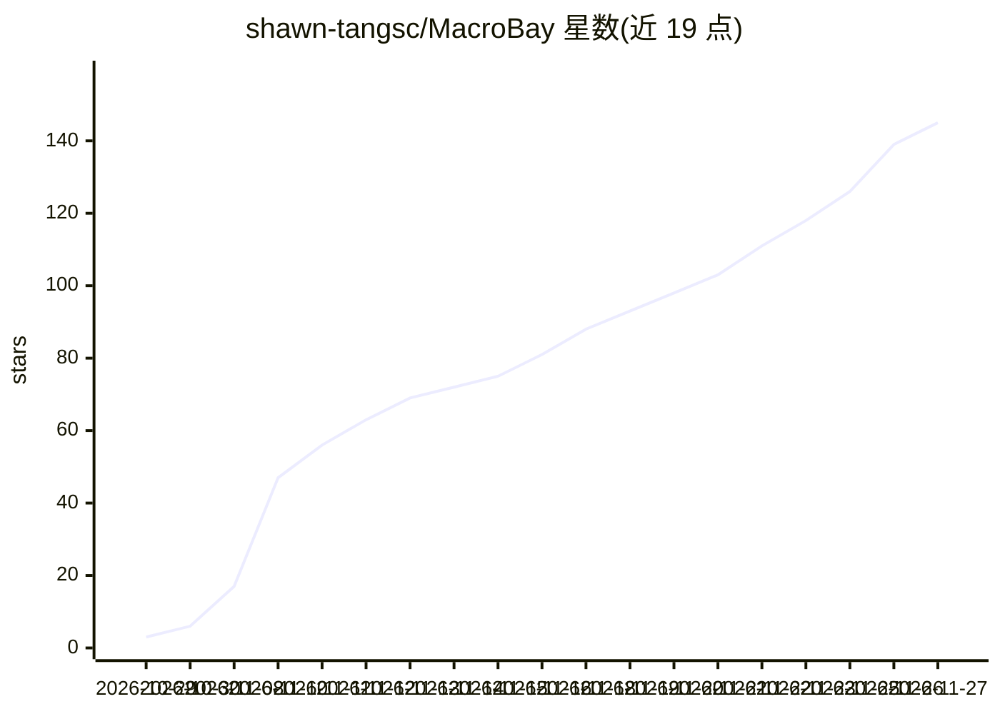

# shawn-tangsc/MacroBay

⭐ 145 · TypeScript · MIT · 推送 2026-11-25 · [GitHub](https://github.com/shawn-tangsc/MacroBay) · 个人维护 · 中文 README

**给加密交易者的本地优先桌面行情分析台，AI 结论附来源与截止时间**

面向加密市场研究者的 Electron 桌面应用：将永续合约资金费率、稳定币供应、ETF 流、恐惧贪婪指数、跨资产走势与宏观日历整合在一屏仪表盘。核心机制是每个数字都携带来源记录与读取截止时间，数据先落入本地存储冻结为快照再由 AI 分析，收集不到的项目显式标注为 gap；分析区分事实/假设/条件/gap/时间边界五要素，并通过 Telegram、Slack、Discord、QQ、Lark 推送通知。内置 841 个经济指标代码与 524 条发布事件。当前为 alpha，构建未签名。

## 筛选速览

| 维度 | 判定 | 备注 |
|---|---|---|
| AI 角色 | `ai-native` | 本体是模型或模型工具 |
| 许可风险 | `permissive` | MIT |
| 部署形态 | `desktop` | 安装包/桌面程序 |
| 模型依赖 | — | README 未给出锁定关系 |
| 硬件要求 | — | 无带数字的原话,不猜 |
| 安装摩擦 | `low` | 无编译、无系统依赖或容器化 |
| 成熟度 | `idea` | |

## 能力要点

- 每个结论附来源记录与 asOf 截止时间，可追溯核验
- 本地优先：数据落本地快照后再分析，无托管账户
- AI 分析区分事实、假设、失效条件、gap 与时间边界
- 通知支持 Telegram/Slack/Discord/QQ/Lark 多通道

## 适用场景

- 每天花几分钟看一份带出处的宏观+加密晨报
- 核验市场结论背后的数据来源与读取时点
- 关注资金费率、稳定币供应与 ETF 流等资金面变化
- 在交易软件之外集中监控会影响判断的变化并收通知

## 场景标签

`金融量化` `科研工具` · 领域:学习与行业

## 证据(README 行号)

> L24: MacroBay is a desktop intelligence desk for crypto. One screen holds what actually moves the market —
> L33: use. It does two other things — it watches for the **changes that would move a call**, and it uses AI to

## 星数曲线

2026-10-29 3 → 2026-11-27 145（+142）

---
*卡片 v1 · prompt 1.4 · 生成 2026-11-27 · 置信度 mid · 依据 README sha `0ed97d45cae2` · [字段定义](../../DATASET.md)*
