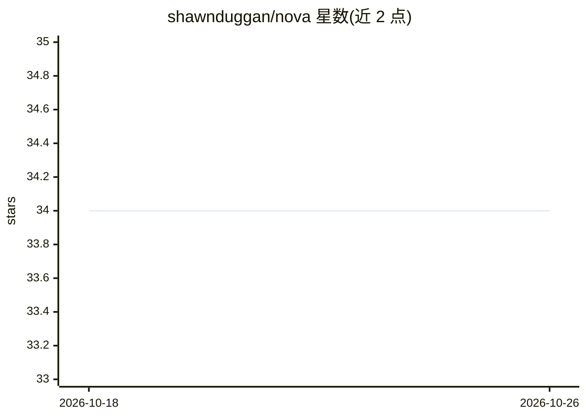

# shawnduggan/nova

⭐ 34 · TypeScript · AGPL-3.0 · 推送 2026-09-29 · [GitHub](https://github.com/shawnduggan/nova) · 个人维护

**Obsidian 的 AI 写作编辑插件：对话式就地编辑文档**

面向 Obsidian 用户的 AI 写作编辑插件：选中文本右键做就地转换、在光标处按对话生成内容、用注释占位符批量填充章节、对选段提出逻辑质疑，以及可逐卡审阅的 Smart Revision 修订流程。自动解析 wikilink/backlink 拉取关联笔记作为上下文。另有纯本地的写作仪表盘、Prose Linter 与写作分析（仅英文），零 AI 成本。支持 Claude/OpenAI/Gemini/Ollama 及 OpenAI 兼容端点，对话保留在本地 vault，无代理服务。核心功能免费（AGPL-3.0），Smart Revision 属于 US$29/年的 Supernova 付费层，不含托管 AI 额度。

## 筛选速览

| 维度 | 判定 | 备注 |
|---|---|---|
| AI 角色 | `ai-native` | 本体是模型或模型工具 |
| 许可风险 | `viral` | AGPL-3.0 |
| 部署形态 | `None` |  |
| 模型依赖 | local-ok | 支持本地模型 |
| 硬件要求 | — | 无带数字的原话,不猜 |
| 安装摩擦 | `low` | 无编译、无系统依赖或容器化 |
| 成熟度 | — | 结构信号不足 |

## 能力要点

- 选区就地编辑、光标处生成、占位符批量 Smart Fill
- Smart Revision 修订卡：前后对照、风险标记、仅应用已接受项
- 自动解析 wikilink/backlink 构建上下文，含 token 预算面板
- 纯本地写作分析（可读性、被动语态、副词密度等），零 AI 成本

## 适用场景

- 在 Obsidian 里让 AI 直接改我选中的段落，而不是复制粘贴
- 写论文或报告时用占位符一次性生成各章节草稿
- 让 AI 质疑我的论点、找出逻辑漏洞
- 用本地 lint 和仪表盘跟踪写作质量，不花 API 费用

## 场景标签

`AI 写作` · 领域:内容生成

## 证据(README 行号)

> L3: AI writing editor, native to Obsidian. Sharpen your prose, refine selected text, write at the cursor, and review loc
> L5: Use the local Ollama API, OpenAI-compatible endpoints like LM Studio, or your own API keys for Claude, OpenAI, and G
> L29: Select text → Right-click → Choose transformation → Watch it change in place. The AI edits exactly what you selecte

## 星数曲线

2026-10-18 34 → 2026-10-26 34（+0）

---
*卡片 v1 · prompt 1.4 · 生成 2026-10-25 · 置信度 high · 依据 README sha `9953e3e9bc09` · [字段定义](../../DATASET.md)*
