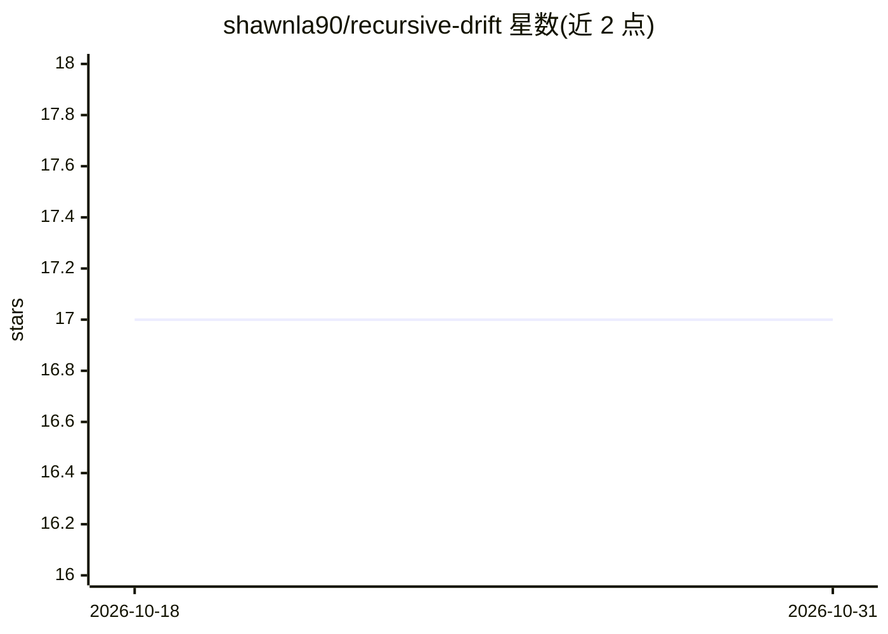

# shawnla90/recursive-drift

⭐ 17 · Mermaid · MIT · 推送 2026-03-14 · [GitHub](https://github.com/shawnla90/recursive-drift) · 个人维护 · 中文 README

**基于 Claude Code 的 CLI-first 方法论：构建有记忆与人格演化的 AI agent**

一套构建随时间积累记忆、写作风格与人格的 AI agent 的方法论，附带可直接复制到项目的编排模板（CLAUDE.md 规则、29 种 anti-slop 语音模式、任务跟踪）和完整构建指南 NioBot。核心机制是自读反馈循环：agent 每次生成前从 SQLite 读取过往文章、分数与 git 提交，经 60+ 正则校验与自动修复后输出；人格通过 5 层 XP 升级体系随 markdown 片段注入演化，无需重训练。运行于 Claude Code 的 Max 订阅（claude -p CLI），无需 API key。限制：核心流程依赖 Claude Code 订阅。

## 筛选速览

| 维度 | 判定 | 备注 |
|---|---|---|
| AI 角色 | `ai-ecosystem` | LLM/agent 周边工具 |
| 许可风险 | `permissive` | MIT |
| 部署形态 | `None` |  |
| 模型依赖 | locked-api |  |
| 硬件要求 | — | 无带数字的原话,不猜 |
| 安装摩擦 | `low` | 无编译、无系统依赖或容器化 |
| 成熟度 | — | 结构信号不足 |

## 能力要点

- 自读反馈循环：读取 SQLite 过往输出与 git 提记作为新输入
- 29 种 anti-slop 模式与 60+ 正则校验、低于 80% 分数自动重试
- 5 层人格演化体系（Spark→Ascended），运行时注入 markdown 片段
- CLI-first，基于 Claude Code Max 订阅运行，零 API key

## 适用场景

- 让 AI agent 写作风格随时间积累而非每次从零开始
- 搭建每日自动生成内容的 agent 流水线
- 给现有项目复制编排模板获得任务跟踪与自我改进循环

## 场景标签

`Agent 记忆` `AI 写作` · 领域:Agent 开发

## 证据(README 行号)

> L21: Recursive Drift solves this. it's a methodology, a set of drop-in templates, and a build guide for creating AI agen
> L30: - **orchestration templates** you drop into any project to give Claude Code task tracking, voice rules, and a self-
> L35: - **CLI-first architecture** that runs on Claude Code with a Max subscription, no API keys, no token billing

## 星数曲线

2026-10-18 17 → 2026-10-31 17（+0）

---
*卡片 v1 · prompt 1.4 · 生成 2026-10-29 · 置信度 high · 依据 README sha `dfda0fe455d4` · [字段定义](../../DATASET.md)*
