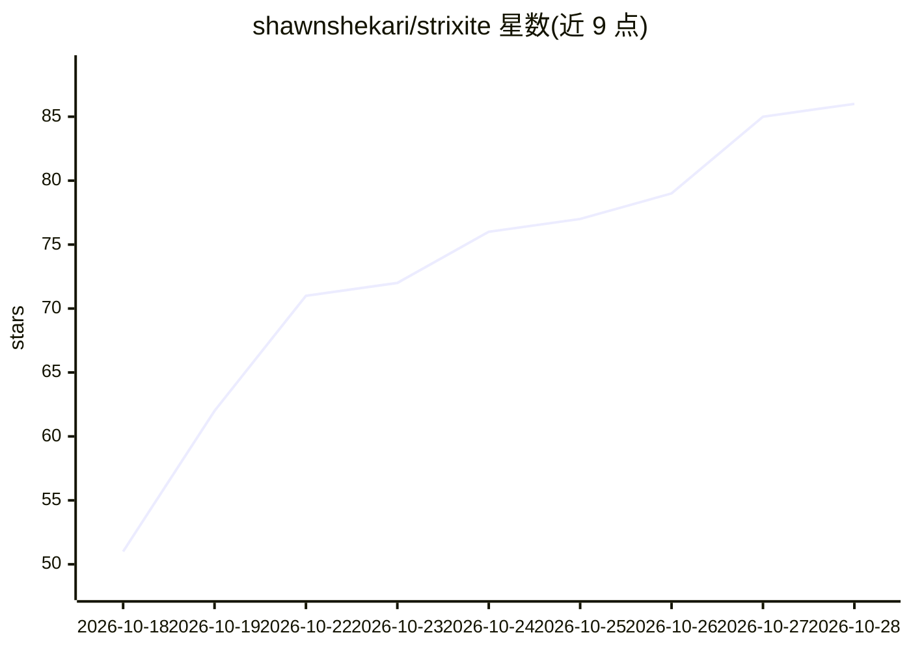

# shawnshekari/strixite

⭐ 86 · C++ · AGPL-3.0 · 推送 2026-10-24 · [GitHub](https://github.com/shawnshekari/strixite) · [官网](https://huggingface.co/wemoh/Qwen3.8-Flash-Next-strixw) · 个人维护

**面向 AMD Strix Halo 的从零手写 HIP LLM 推理引擎**

个人开发者用 HIP 从零编写的 LLM 推理引擎，专为一个芯片（AMD Strix Halo, gfx1151）和一个模型（Qwen3.8-Flash-Next，512 专家 MoE + 线性注意力）设计。不依赖 llama.cpp/ggml/厂商库，内核手写并与 CPU 参考实现比对。提供 OpenAI 兼容服务器（流式、工具调用、结构化输出）、多 token 预测、RAM/磁盘提示缓存、512k 上下文（YaRN + 8-bit KV cache）、图像输入。仅支持 Linux + Strix Halo + 128GB 内存，Windows/macOS 不支持；权重约 115 GiB 需单独从 Hugging Face 下载；服务器默认无鉴权监听所有接口。

## 筛选速览

| 维度 | 判定 | 备注 |
|---|---|---|
| AI 角色 | `ai-ecosystem` | LLM/agent 周边工具 |
| 许可风险 | `viral` | AGPL-3.0 |
| 部署形态 | `None` |  |
| 模型依赖 | — | README 未给出锁定关系 |
| 硬件要求 | — | 无带数字的原话,不猜 |
| 安装摩擦 | `medium` | 含编译或系统依赖之一 |
| 成熟度 | — | 结构信号不足 |

## 能力要点

- 手写 HIP 内核，不依赖 llama.cpp/ggml/厂商库，内核与 CPU 参考实现比对
- OpenAI 兼容服务器：流式、工具调用、推理与结构化输出
- 512k 上下文（YaRN + 8-bit KV cache），RAM 与磁盘提示缓存
- 容器镜像含服务器与 ROCm 运行时，可用 podman/docker 运行

## 适用场景

- 在 Strix Halo 迷你主机上本地运行 Qwen3.8-Flash-Next 做长上下文 agent 编码
- 将任意 OpenAI 兼容客户端指向本地 5300 端口使用模型
- 在专用 Linux 机器上搭建长对话不降速的本地推理服务

## 场景标签

`推理引擎` · 领域:训练与推理

## 证据(README 行号)

> L50: strixite is an LLM inference engine I wrote from scratch in HIP for exactly one chip and one model:
> L62: - **OpenAI-compatible server** - chat completions with streaming, tool calls, reasoning and structured output

## 星数曲线

2026-10-18 51 → 2026-10-28 86（+35）

---
*卡片 v1 · prompt 1.4 · 生成 2026-10-24 · 置信度 high · 依据 README sha `feb99ecd5596` · [字段定义](../../DATASET.md)*
