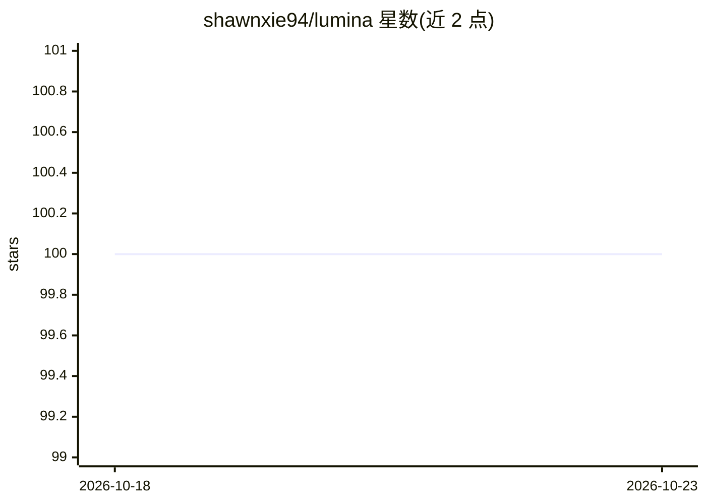

# shawnxie94/lumina

⭐ 100 · Python · MIT · 推送 2026-10-22 · [GitHub](https://github.com/shawnxie94/lumina) · [官网](https://lumina.shawnxie.top) · 个人维护 · 中文 README

**个人阅读与信息管理工作台：网页采集+AI 摘要+知识库**

由 Web 应用、FastAPI 后端与浏览器扩展组成的信息管理工作台：通过扩展一键采集网页全文或选中内容，基于 Defuddle 解析后存入结构化文章库；后台 AI 任务流水线生成摘要、要点、引语、大纲、翻译、自动分类与相似文章推荐，任务链支持续跑、修复、取消与重试。另提供专栏写作、文章批注、评论协作、RSS 订阅、备份导出，以及可选的主题知识解析（本地 CLI+Bridge 连接知识项目）。面向个人阅读管理与内容整理用户，Docker Compose 一键部署，内置中英文界面。

## 筛选速览

| 维度 | 判定 | 备注 |
|---|---|---|
| AI 角色 | `ai-enhanced` | 去掉 AI 部分产品仍成立 |
| 许可风险 | `permissive` | MIT |
| 部署形态 | `self-host` | docker 或自建部署 |
| 模型依赖 | — | README 未给出锁定关系 |
| 硬件要求 | — | 无带数字的原话,不猜 |
| 安装摩擦 | `low` | 无编译、无系统依赖或容器化 |
| 成熟度 | — | 结构信号不足 |

## 能力要点

- 浏览器扩展一键全文/选区采集，基于 Defuddle 解析
- AI 任务流水线：摘要、要点、翻译、自动分类、相似推荐
- 可选主题知识解析（本地 CLI + Bridge 连接知识项目）
- 专栏写作、批注、评论、RSS、备份与 Markdown 导出

## 适用场景

- 把网页文章采集到统一库里做深度阅读与批注
- 让 AI 自动生成摘要、分类和相似文章推荐
- 在自有库之上整理并发布长阅读专栏

## 场景标签

`知识库管理` `网页抓取` · 领域:效率与自动化

## 证据(README 行号)

> L7: Lumina is an information management workspace that combines a web app, FastAPI backend, and browser extension to hel
> L14: - **AI insight pipeline**: generate summaries, key points, quotes, outlines, translations, auto-classification, and
> L16: - **Optional topic knowledge**: enable Topic settings, install Lumina CLI locally, connect Bridge to a knowledge pr

## 星数曲线

2026-10-18 100 → 2026-10-23 100（+0）

---
*卡片 v1 · prompt 1.4 · 生成 2026-10-23 · 置信度 mid · 依据 README sha `ee806eb4f04f` · [字段定义](../../DATASET.md)*
