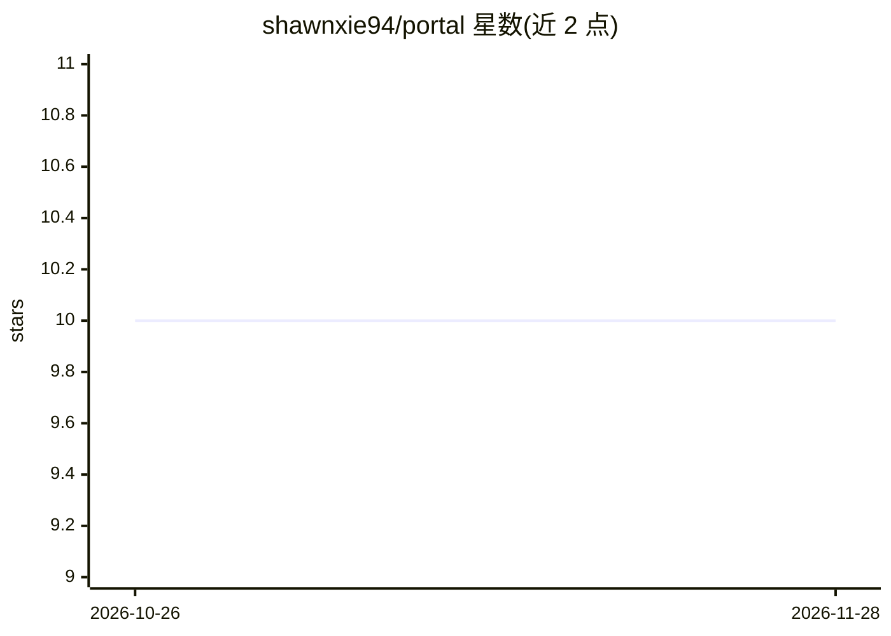

# shawnxie94/portal

⭐ 10 · Astro · MIT · 推送 2026-08-11 · [GitHub](https://github.com/shawnxie94/portal) · [官网](http://shawnxie.top) · 个人维护 · 中文 README

**「肖恩聊技术」的个人门户站点**

README 仅说明这是一个名为「肖恩聊技术」的个人门户站点，提供站点访问入口，并通过公众号二维码引导关注以获取原创技术文章推送。README 未描述门户的具体功能模块、技术栈或部署方式，主题标签显示其内容涉及 AI、后端、博客、代码可视化与个人经历，但正文无可验证的细节。

## 筛选速览

| 维度 | 判定 | 备注 |
|---|---|---|
| AI 角色 | `ai-knowledge` | 知识聚合/清单类 |
| 许可风险 | `permissive` | MIT |
| 部署形态 | `None` |  |
| 模型依赖 | — | README 未给出锁定关系 |
| 硬件要求 | — | 无带数字的原话,不猜 |
| 安装摩擦 | `low` | 无编译、无系统依赖或容器化 |
| 成熟度 | — | 结构信号不足 |

## 能力要点

- 提供个人门户站点的在线访问入口
- 关联微信公众号用于推送原创技术文章

## 适用场景

- 访问作者的个人门户阅读技术内容
- 关注公众号获取文章更新推送

## 场景标签

 · 领域:个人门户/内容聚合

## 证据(README 行号)

> L3: 肖恩聊技术个人门户。
> L8: 扫码关注“肖恩聊技术”公众号，原创技术文章第一时间推送。

## 星数曲线

2026-10-26 10 → 2026-11-28 10（+0）

---
*卡片 v1 · prompt 1.4 · 生成 2026-11-19 · 置信度 low · 依据 README sha `57bde30d9faa` · [字段定义](../../DATASET.md)*
