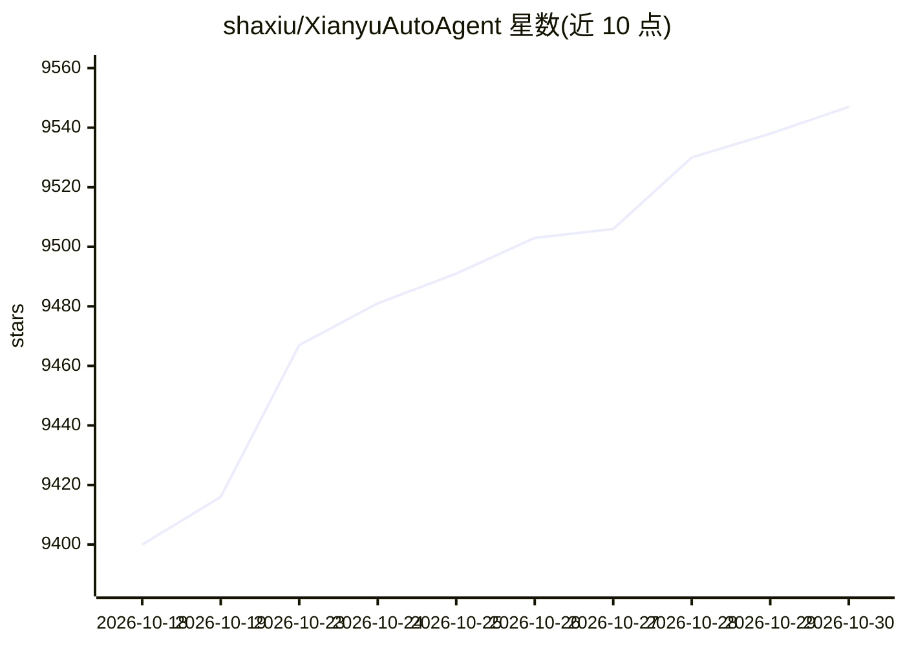

# shaxiu/XianyuAutoAgent

⭐ 9,547 · Python · GPL-3.0 · 推送 2026-06-10 · [GitHub](https://github.com/shaxiu/XianyuAutoAgent) · 个人维护 · 中文 README

**面向闲鱼卖家的 LLM 自动客服值守机器人**

基于 Python 的闲鱼平台客服自动化系统：通过 LLM 生成自动回复，保存完整会话历史作为上下文输入；基于提示工程做意图识别，将对话动态分发给议价、技术、客服等多专家 Agent；议价采用阶梯降价策略，技术支持整合网络搜索。prompts 目录下的提示词文件可自定义各专家行为。运行需 Python 3.8+，克隆仓库后运行 main.py。项目声明仅供学习交流，可能随时停止更新或删除。

## 筛选速览

| 维度 | 判定 | 备注 |
|---|---|---|
| AI 角色 | `ai-native` | 本体是模型或模型工具 |
| 许可风险 | `viral` | GPL-3.0 |
| 部署形态 | `None` |  |
| 模型依赖 | — | README 未给出锁定关系 |
| 硬件要求 | — | 无带数字的原话,不猜 |
| 安装摩擦 | `low` | 无编译、无系统依赖或容器化 |
| 成熟度 | — | 结构信号不足 |

## 能力要点

- 会话历史存储作为 LLM 上下文输入
- 意图识别后动态分发议价/技术/客服多专家 Agent
- 阶梯降价议价策略与网络搜索整合
- prompts 目录可自定义各专家提示词

## 适用场景

- 闲鱼店铺 7×24 小时自动回复买家消息
- 让 AI 按阶梯策略代替我议价
- 技术类问题自动整合网络搜索后答复

## 场景标签

`聊天机器人` `多智能体` · 领域:Agent 开发

## 证据(README 行号)

> L5: 专为闲鱼平台打造的AI值守解决方案，实现闲鱼平台7×24小时自动化值守，支持多专家协同决策、智能议价和上下文感知对话。
> L13: |专家路由|LLM prompt+规则路由|基于提示工程的意图识别 → 专家Agent动态分发，支持议价/技术/客服多场景切换|

## 星数曲线

2026-10-18 9,400 → 2026-10-30 9,547（+147）

---
*卡片 v1 · prompt 1.4 · 生成 2026-10-20 · 置信度 high · 依据 README sha `21cc39e0d40f` · [字段定义](../../DATASET.md)*
