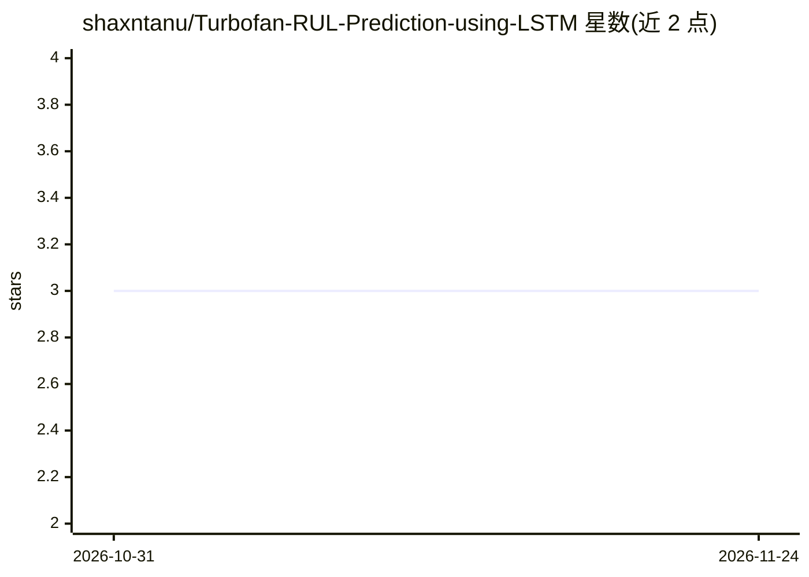

# shaxntanu/Turbofan-RUL-Prediction-using-LSTM

⭐ 3 · HTML · MIT · 推送 2026-11-22 · [GitHub](https://github.com/shaxntanu/Turbofan-RUL-Prediction-using-LSTM) · [官网](https://turbofan-rul-prediction-using-lstm.vercel.app) · 个人维护

**基于 NASA C-MAPSS 数据的涡扇发动机 RUL 预测研究项目**

面向 NASA C-MAPSS FD001-FD004 基准数据的端到端剩余使用寿命（RUL）预测项目：以堆叠 LSTM 与 Ridge 基线在多变量传感器时间序列上做预测，训练时按验证 MAE 选模、在官方测试轨迹上评估，并输出验证校准的 split-conformal 区间。项目包含可复现实验管线、迁移研究、可靠性/鲁棒性研究（多种子、可选 XGBoost/CNN）、Streamlit 交互应用、React 结果仪表盘与维护情景分析（需 Julia 再生成表）。数据为模拟数据，作者声明非现场验证的维护策略。

## 筛选速览

| 维度 | 判定 | 备注 |
|---|---|---|
| AI 角色 | `ai-native` | 本体是模型或模型工具 |
| 许可风险 | `permissive` | MIT |
| 部署形态 | `desktop` | 安装包/桌面程序 |
| 模型依赖 | — | README 未给出锁定关系 |
| 硬件要求 | — | 无带数字的原话,不猜 |
| 安装摩擦 | `low` | 无编译、无系统依赖或容器化 |
| 成熟度 | — | 结构信号不足 |

## 能力要点

- LSTM 与 Ridge 基线的 FD001-FD004 可复现基准与迁移研究
- 验证校准的 split-conformal 95% RUL 区间
- 多种子可靠性/鲁棒性研究（传感器压力、短历史、留一子集）
- Streamlit 应用、React 仪表盘与维护 What-If 情景分析

## 适用场景

- 在 C-MAPSS 基准上训练和评估 RUL 预测模型
- 复现迁移学习与不确定性校准实验
- 通过仪表盘查看跨子集基准与可靠性结果
- 做维护触发的回溯性情景分析

## 场景标签

`科研工具` · 领域:学习与行业

## 证据(README 行号)

> L1: # Turbofan Remaining Useful Life Observatory
> L6: An end-to-end NASA C-MAPSS benchmark for aircraft-engine remaining useful life (RUL), with an LSTM and Ridge baselin

## 星数曲线

2026-10-31 3 → 2026-11-24 3（+0）

---
*卡片 v1 · prompt 1.4 · 生成 2026-11-21 · 置信度 high · 依据 README sha `b8092ce69f53` · [字段定义](../../DATASET.md)*
