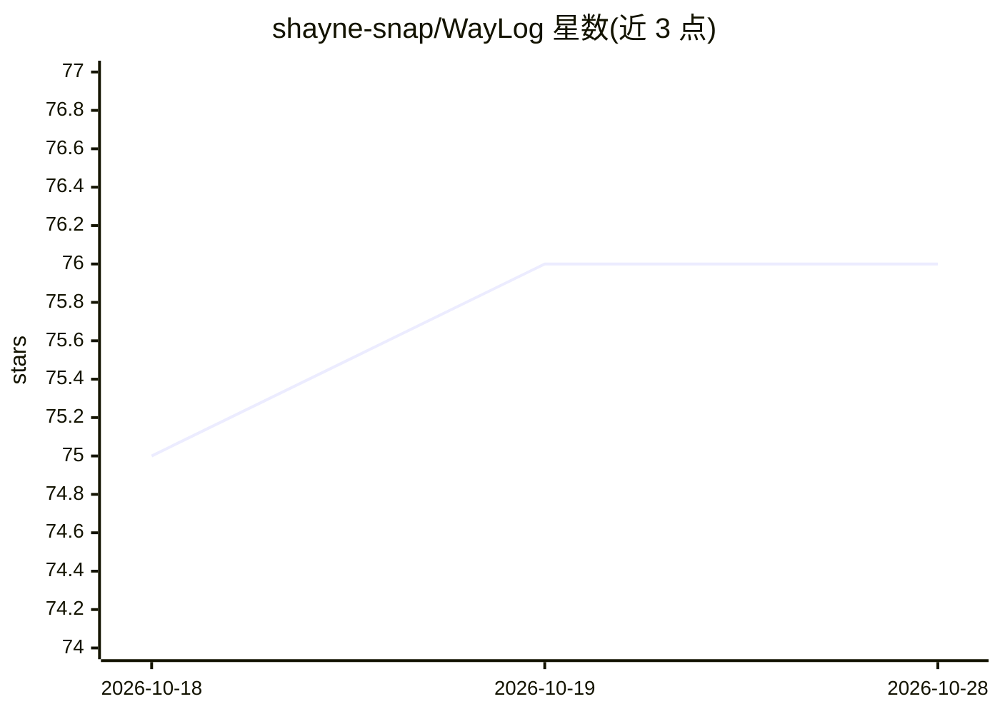

# shayne-snap/WayLog

⭐ 76 · TypeScript · Apache-2.0 · 推送 2026-01-17 · [GitHub](https://github.com/shayne-snap/WayLog) · [官网](https://open-vsx.org/extension/waylog/waylog) · 个人维护 · 中文 README

**本地优先的 VS Code 扩展：自动保存并导出多款 AI 编程助手聊天记录**

面向使用 AI 编程助手的开发者，WayLog 是 VS Code/Cursor 扩展，在本地直接读取各 AI 扩展的 SQLite 数据库与 JSON 日志，以只读方式聚合并后台自动保存聊天记录到工作区 .waylog 文件夹，形成 git 友好的知识库。开箱支持 Cursor、Claude Code、GitHub Copilot、通义灵码、CodeBuddy、Roo Code、Cline、Kilo、OpenAI Codex 等。兼容 macOS（Intel/Apple Silicon）与 Windows（x64/ARM64），Apache-2.0 许可，从 VS Code Marketplace 安装。

## 筛选速览

| 维度 | 判定 | 备注 |
|---|---|---|
| AI 角色 | `ai-ecosystem` | LLM/agent 周边工具 |
| 许可风险 | `permissive` | Apache-2.0 |
| 部署形态 | `None` |  |
| 模型依赖 | — | README 未给出锁定关系 |
| 硬件要求 | — | 无带数字的原话,不猜 |
| 安装摩擦 | `low` | 无编译、无系统依赖或容器化 |
| 成熟度 | — | 结构信号不足 |

## 能力要点

- 后台自动保存，无需手动操作
- 直接读取本地 SQLite 数据库与 JSON 日志，数据不离开设备
- 只读方式访问原始聊天记录，不修改不删除
- 统一聚合 9 种 AI 编程助手的聊天历史

## 适用场景

- 我在切换 IDE 或关闭窗口后仍保留 AI 对话上下文
- 把我分散在多个 AI 编程助手中的对话统一成一个知识库
- 把 AI 聊天记录以 git 友好格式保存并纳入版本管理

## 场景标签

 · 领域:开发者工具/AI 数据管理

## 证据(README 行号)

> L20: - **Local-First Architecture**: WayLog runs locally, directly accessing the SQLite databases and JSON logs on your 
> L24: - **Unified History Aggregation**: Automatically discovers and reads chat history from supported AI extensions inst

## 星数曲线

2026-10-18 75 → 2026-10-28 76（+1）

---
*卡片 v1 · prompt 1.4 · 生成 2026-10-24 · 置信度 high · 依据 README sha `783a2c7eca6e` · [字段定义](../../DATASET.md)*
