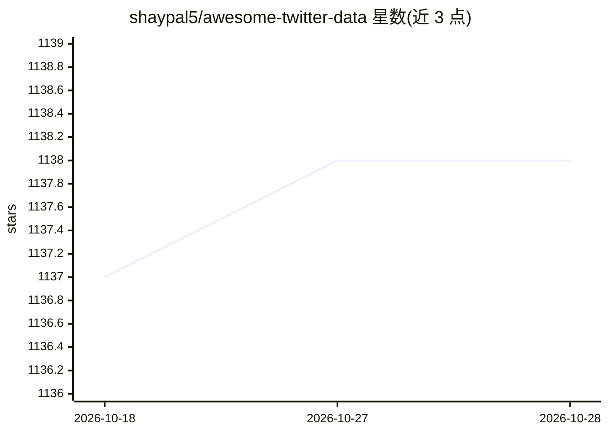

# shaypal5/awesome-twitter-data

⭐ 1,138 · CC0-1.0 · 推送 2026-05-29 · [GitHub](https://github.com/shaypal5/awesome-twitter-data) · 个人维护

**Twitter 数据集与相关资源的策展清单**

以 CC0 许可发布的 Twitter 数据集聚合清单：按全文推文、推文 ID、标注/基准、元数据与图网络等类别组织条目，另收录已失效数据集。每条目按“名称 {许可} [规模] - 可获取性；简述”格式给出，可获取性标注涵盖全文、需水合的推文 ID、标注数据、图数据、需联系作者、部分可用与已失效等，部分条目附许可与规模信息，接受社区 PR 补充。

## 筛选速览

| 维度 | 判定 | 备注 |
|---|---|---|
| AI 角色 | `ai-knowledge` | 知识聚合/清单类 |
| 许可风险 | `viral` | CC0-1.0 |
| 部署形态 | `None` |  |
| 模型依赖 | — | README 未给出锁定关系 |
| 硬件要求 | — | 无带数字的原话,不猜 |
| 安装摩擦 | `low` | 无编译、无系统依赖或容器化 |
| 成熟度 | — | 结构信号不足 |

## 能力要点

- 按数据类型分类组织：全文/推文ID/标注基准/元数据/图网络/已失效
- 每条目标注许可、规模与可获取性
- 清单本身以 CC0 发布，接受 PR 与邮件补充

## 适用场景

- 为社交媒体 NLP 研究查找情感分析、立场检测等标注数据集
- 为社会网络分析寻找 Twitter 图/关注网络数据集
- 确认某 Twitter 数据集当前是否仍可获取（含 Lost 标注）

## 场景标签

`精选清单` · 领域:学习与行业

## 证据(README 行号)

> L8: A list of Twitter datasets and related resources, released under `CC0 <https://creativecommons.org/publicdomain/zero
> L38: Twitter Datasets

## 星数曲线

2026-10-18 1,137 → 2026-10-28 1,138（+1）

---
*卡片 v1 · prompt 1.4 · 生成 2026-10-21 · 置信度 high · 依据 README sha `4d4a2d27aeb8` · [字段定义](../../DATASET.md)*
