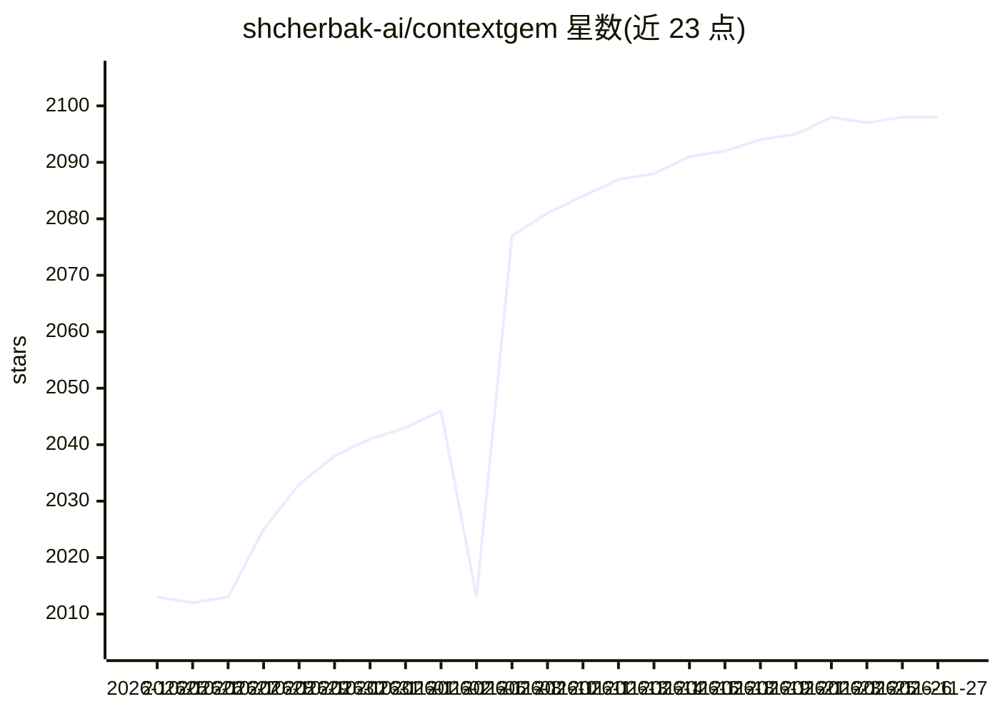

# shcherbak-ai/contextgem

⭐ 2,098 · Python · Apache-2.0 · 推送 2026-11-21 · [GitHub](https://github.com/shcherbak-ai/contextgem) · [官网](https://contextgem.shcherbak.ai/) · 个人维护

**开发者用声明式框架从文档中抽取结构化数据与洞察**

开源 Python 框架，通过 LLM 与决策模型从文档中提取结构化数据：用户以自然语言描述要抽取的概念，框架自动生成提示词、定义数据模型、校验输出类型，并将每条抽取结果回溯到来源段落或句子。支持 aspects/concepts 的嵌套上下文、可复用与可序列化的抽取管线，并通过 Docling 转换 PDF、DOCX 等多种文件格式。1.0 版新增决策模型，对封闭问题输出各答案的概率；模型组可将不同问题路由给 LLM 或决策模型并支持回退。

## 筛选速览

| 维度 | 判定 | 备注 |
|---|---|---|
| AI 角色 | `ai-native` | 本体是模型或模型工具 |
| 许可风险 | `permissive` | Apache-2.0 |
| 部署形态 | `library` | 以包/库形式分发 |
| 模型依赖 | local-ok | 支持本地模型 |
| 硬件要求 | — | 无带数字的原话,不猜 |
| 安装摩擦 | `low` | 无编译、无系统依赖或容器化 |
| 成熟度 | — | 结构信号不足 |

## 能力要点

- 自然语言描述即抽取，提示词由框架生成，无需手写
- 每条抽取结果回溯到来源段落/句子，可附带理由
- LLM 与决策模型组成模型组，按问题类型路由并支持回退
- 经 Docling 支持 PDF、DOCX、图像等约 30 种文件格式转换

## 适用场景

- 从合同中抽取付款条款、终止条款等并保留原文出处
- 批量对文档回答封闭问题（是/否、标签、评级）并按阈值决策
- 在 agent 工作流中作为文档抽取工具或文档摄取元数据环节

## 场景标签

`文档解析` · 领域:知识与检索

## 证据(README 行号)

> L31: ContextGem is a free, open-source framework that does the work around the models for you: the prompts, the data mod
> L60: |**Models**|Any cloud or local LLM through LiteLLM: OpenAI, Anthropic, Google, Azure OpenAI, xAI, Ollama, LM Studio

## 星数曲线

2026-10-25 2,013 → 2026-11-27 2,098（+85）

---
*卡片 v1 · prompt 1.4 · 生成 2026-11-23 · 置信度 high · 依据 README sha `fa0b6e835d49` · [字段定义](../../DATASET.md)*
