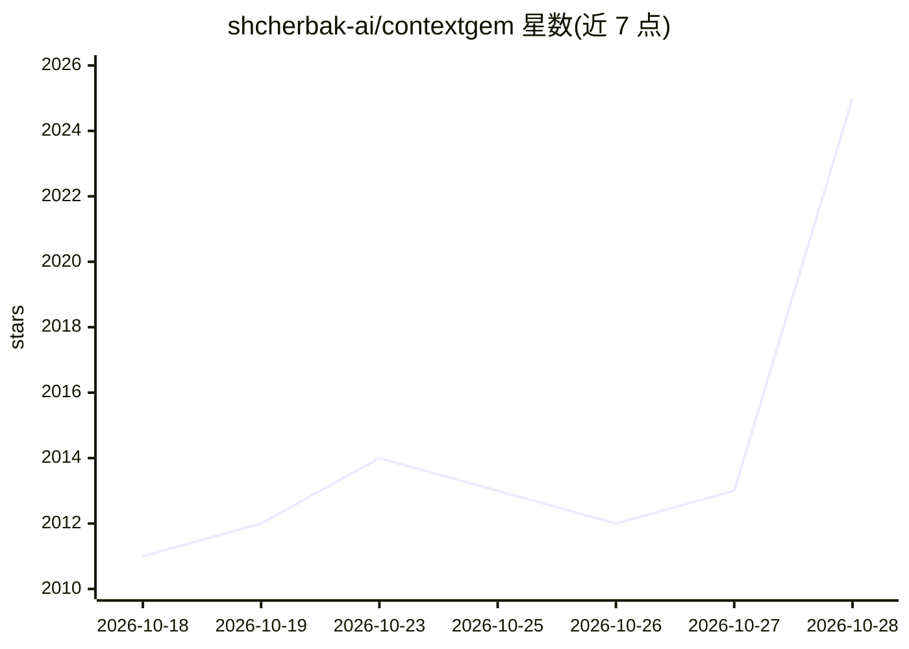

# shcherbak-ai/contextgem

⭐ 2,025 · Python · Apache-2.0 · 推送 2026-10-27 · [GitHub](https://github.com/shcherbak-ai/contextgem) · [官网](https://contextgem.shcherbak.ai/) · 个人维护

**用 LLM 与决策模型从文档抽取结构化数据的 Python 框架**

面向需要从单份文档做深度抽取的开发者：以自然语言描述要抽取的 Aspect 与 Concept，框架自动生成 prompt 并输出经校验的类型化结果（文本/数值/日期/布尔/标签/评分/JSON），每条结果回溯到原句或段落，可附理由。支持两类模型：经 LiteLLM 接入任意云端或本地 LLM；决策模型回答封闭问题并给出各答案概率。模型组可按问题类型分派并设置回退。设计上逐段通读全文而非检索切片，不做跨文档查询。以 Python 包（pip/uv）提供，Apache 2.0 许可。

## 筛选速览

| 维度 | 判定 | 备注 |
|---|---|---|
| AI 角色 | `ai-native` | 本体是模型或模型工具 |
| 许可风险 | `permissive` | Apache-2.0 |
| 部署形态 | `library` | 以包/库形式分发 |
| 模型依赖 | local-ok | 支持本地模型 |
| 硬件要求 | — | 无带数字的原话,不猜 |
| 安装摩擦 | `low` | 无编译、无系统依赖或容器化 |
| 成熟度 | — | 结构信号不足 |

## 能力要点

- 自然语言描述抽取目标，自动生成 prompt，输出类型化且经校验的结果
- 每条抽取结果回溯到原文段落或句子，可附 justification
- 决策模型对封闭问题输出各答案概率，模型组按问题类型分派并支持回退
- 通过 LiteLLM 接入 OpenAI/Anthropic/Azure/Ollama/LM Studio 等云端与本地模型

## 适用场景

- 从合同等法律文档中抽取条款、当事人、日期等结构化字段并溯源
- 在 agent 工作流中作为文档抽取工具或决策点的封闭问题判定
- 批量处理需要逐段通读、不容漏检的单文档深度分析任务

## 场景标签

`文档解析` · 领域:知识与检索

## 证据(README 行号)

> L19:  You write a concept in plain language and make one call. You get every extracted fact with the line of the documen
> L27: ContextGem is a free, open-source framework that does the work around the models for you: the prompts, the data mod
> L52: |**How it answers**|Writes the answer, which ContextGem validates into typed items|Gives the probability of each po

## 星数曲线

2026-10-18 2,011 → 2026-10-28 2,025（+14）

---
*卡片 v1 · prompt 1.4 · 生成 2026-10-21 · 置信度 high · 依据 README sha `e66ebc8a0ee2` · [字段定义](../../DATASET.md)*
