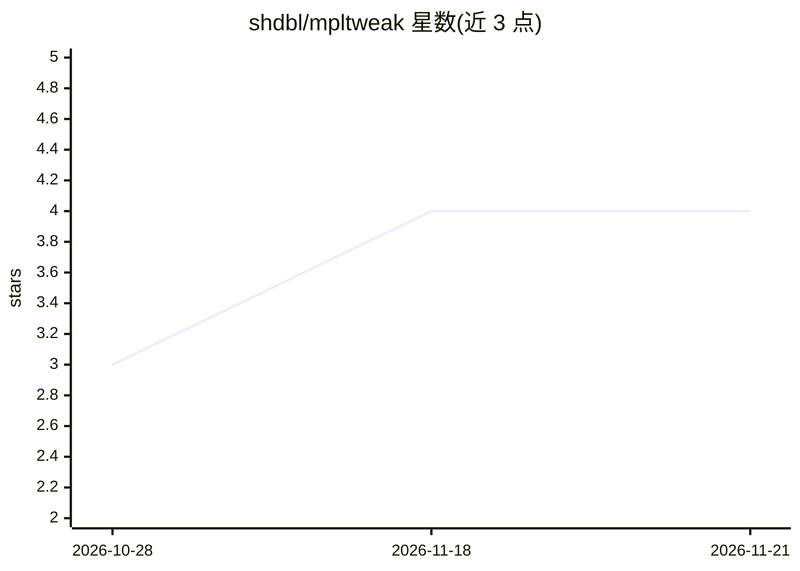

# shdbl/mpltweak

⭐ 4 · Python · MIT · 推送 2026-10-30 · [GitHub](https://github.com/shdbl/mpltweak) · 个人维护 · 中文 README

**像拖 PPT 一样交互调整 matplotlib 排版并写回代码**

面向画多面板科研图的用户：用图形窗口直接拖动子图、调字号、对齐均分，参数先落盘到 .tweak_params JSON，确认后才通过 AST 定位写回 .py 源码；写回分原位改常量与末尾追加块两条通道，并经语法解析、子进程重跑、语义比对三道验证，未通过自动回滚。提供 CLI（describe/check/apply/revert/demo）与 PyQt5/Tk 图形后端，另附供 Agent 读写的 Skill 手册；写回过程不依赖 LLM，输出确定性。

## 筛选速览

| 维度 | 判定 | 备注 |
|---|---|---|
| AI 角色 | `ai-enhanced` | 去掉 AI 部分产品仍成立 |
| 许可风险 | `permissive` | MIT |
| 部署形态 | `library` | 以包/库形式分发 |
| 模型依赖 | — | README 未给出锁定关系 |
| 硬件要求 | — | 无带数字的原话,不猜 |
| 安装摩擦 | `low` | 无编译、无系统依赖或容器化 |
| 成熟度 | — | 结构信号不足 |

## 能力要点

- 拖动/吸附/多选对齐/悬停调字号的交互窗口，参数先存 JSON、确认后才写回源码
- 基于 AST 的确定性写回：原位改常量或末尾追加 auto layout 块，未命中行逐字节不变
- 写回前自动备份，写回时过语法/重跑/语义三道检查，任一不过自动回滚
- 自带 Agent Skill 手册，可交由能读写本地文件的 Agent 代为执行命令

## 适用场景

- 多面板科研图排版反复微调，不想每次重跑脚本看效果
- 让 AI Agent 代为跑命令完成装包、调图、写回的流程
- 已有一批 matplotlib 绘图脚本，只想改位置与字号不动内容

## 场景标签

`科研工具` · 领域:学习与行业

## 证据(README 行号)

> L41: mpltweak 自带一份**给 AI 助手（Agent）看的手册（Skill）**：把这份手册交给能读写你电脑文件的 Agent，它会替你把命令全部敲完。所以有两条路可选——**用的是同一个工具、同一份 Skill**，区别只在
> L237: **写回是确定性的，不靠猜。** 它不是文本层正则替换（那样别处的 `0.08` 会被误伤），而是把脚本解析成 **AST（语法树）**，定位到"哪一句在建图、哪一个 `Constant` 是位置"，再顺着变量名绑定到目标对象；

## 星数曲线

2026-10-28 3 → 2026-11-21 4（+1）

---
*卡片 v1 · prompt 1.4 · 生成 2026-11-21 · 置信度 high · 依据 README sha `eb36622afc2a` · [字段定义](../../DATASET.md)*
