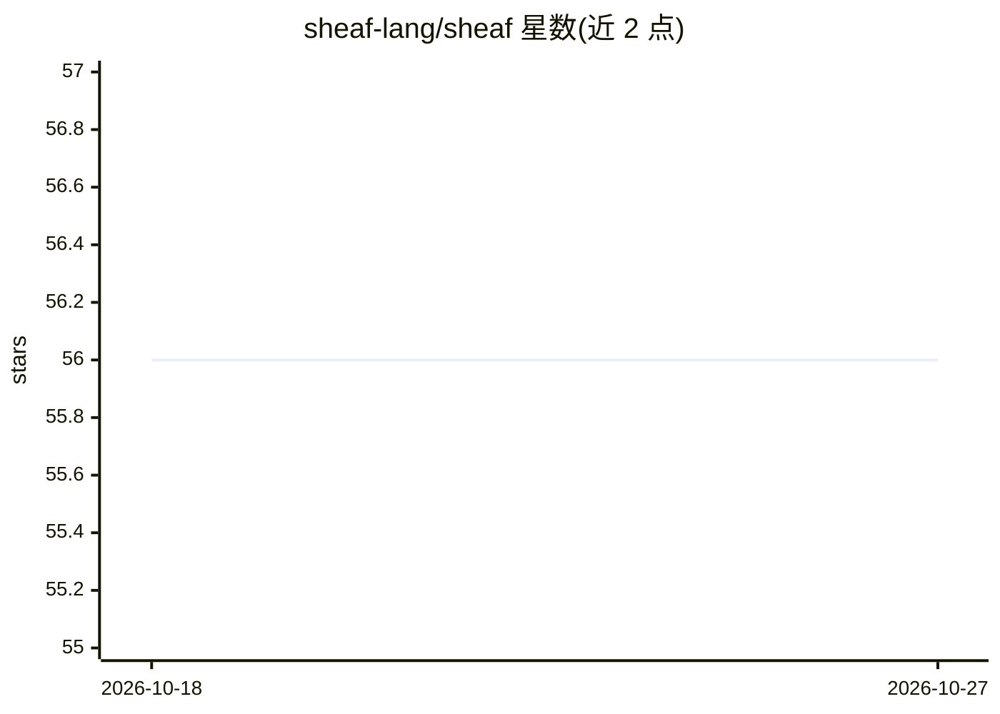

# sheaf-lang/sheaf

⭐ 56 · Rust · MIT · 推送 2026-10-24 · [GitHub](https://github.com/sheaf-lang/sheaf) · [官网](https://www.sheaf-lang.org) · 组织维护

**面向机器学习的函数式 Lisp 方言，编译到 GPU 运行**

Sheaf 是一门用于机器学习的函数式语言：语法受 Clojure 启发，提供同像性、不可变性、threading 宏与 REPL 驱动开发。编译器以 StableHLO 为中间表示，通过 IREE 在 CUDA、Metal、Vulkan 和 CPU 上运行；在 StableHLO 代码生成前执行反向模式自动微分，并对纯函数按运行时形状做 JIT 编译。运行时以单一原生二进制发布（Linux 与 Apple Silicon），无需 Python 环境。README 声明语言与编译器接口仍可能在版本间变动。适合需要在 GPU 上以 Lisp 风格编写张量程序的开发者。

## 筛选速览

| 维度 | 判定 | 备注 |
|---|---|---|
| AI 角色 | `ai-ecosystem` | LLM/agent 周边工具 |
| 许可风险 | `permissive` | MIT |
| 部署形态 | `None` |  |
| 模型依赖 | — | README 未给出锁定关系 |
| 硬件要求 | — | 无带数字的原话,不猜 |
| 安装摩擦 | `medium` | 含编译或系统依赖之一 |
| 成熟度 | `idea` | |

## 能力要点

- 编译到 StableHLO，经 IREE 运行于 CUDA/Metal/Vulkan/CPU
- StableHLO 生成前的反向模式自动微分
- 纯函数按运行时形状自动 JIT 编译
- 单一原生二进制运行时，无需 Python 环境

## 适用场景

- 用 Lisp 风格语法在 REPL 中编写与调试张量程序
- 编写并训练 Transformer 类模型（含 nanoGPT 示例）
- 用宏从同一层列表派生训练、残差与监控三种计算图

## 场景标签

 · 领域:机器学习/编程语言与编译器

## 证据(README 行号)

> L7: Sheaf is a functional language for machine learning that combines the
> L16: - **GPU-first**: compiles to StableHLO
> L19: - **Reverse-mode autodiff**: differentiates supported tensor programs before

## 星数曲线

2026-10-18 56 → 2026-10-27 56（+0）

---
*卡片 v1 · prompt 1.4 · 生成 2026-10-24 · 置信度 high · 依据 README sha `a80c50847db2` · [字段定义](../../DATASET.md)*
