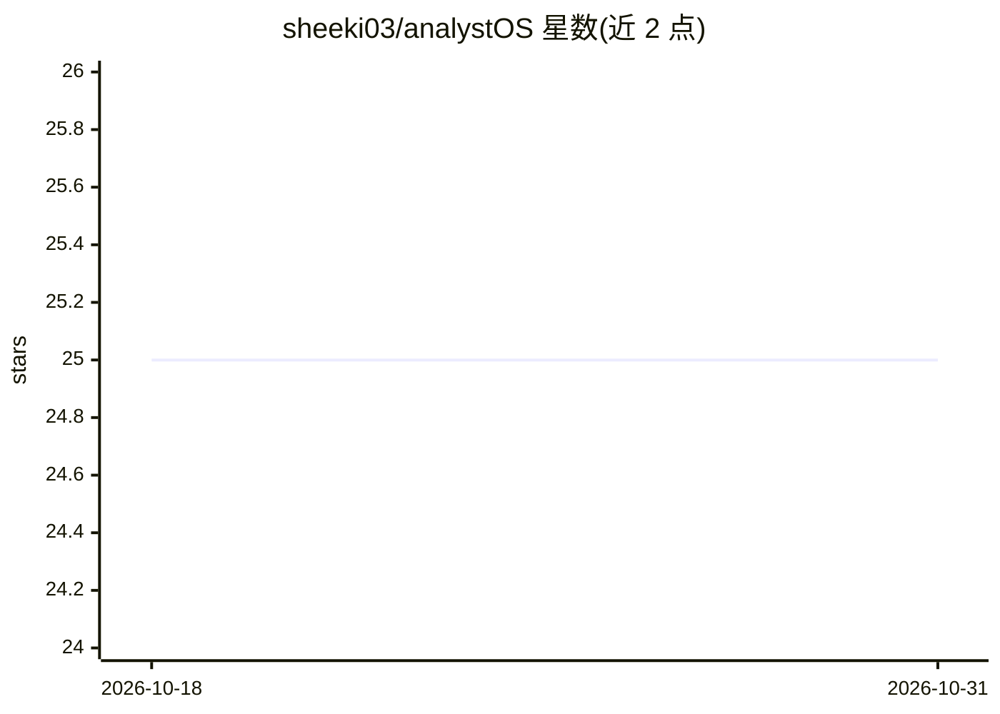

# sheeki03/analystOS

⭐ 25 · Python · 推送 2026-07-07 · [GitHub](https://github.com/sheeki03/analystOS) · 个人维护

**面向股票与加密货币的 AI 研究平台，含 Web UI 与 Notion 自动化**

基于 Streamlit 的金融研究平台，通过 OpenRouter 接入 50+ AI 模型，覆盖股票（OpenBB/FMP/SEC 文件）、加密货币（CoinGecko 实时与历史行情）及跨资产对比分析。支持上传 PDF/DOCX 等文档、抓取网页、用 FAISS 向量检索做 RAG 问答，并提供 LangChain ODR 多智能体深度研究。可连接 Notion 数据库实现零接触自动研究与报告发布。限制：加密数据仅 USD 交易对、无分钟级间隔、历史最多 365 天、仅收盘价。

## 筛选速览

| 维度 | 判定 | 备注 |
|---|---|---|
| AI 角色 | `ai-native` | 本体是模型或模型工具 |
| 许可风险 | `none` | — |
| 部署形态 | `None` |  |
| 模型依赖 | locked-api |  |
| 硬件要求 | — | 无带数字的原话,不猜 |
| 安装摩擦 | `low` | 无编译、无系统依赖或容器化 |
| 成熟度 | — | 结构信号不足 |

## 能力要点

- 自然语言查询路由到 19 个金融数据工具
- FAISS 向量检索的 RAG 问答与多格式文档 OCR 处理
- Notion 自动化：监听新条目自动研究并发布报告
- 跨资产对比（波动率归一化、质押收益 vs 股息）

## 适用场景

- 用自然语言查询股票财务数据与 SEC 文件
- 对比加密货币与股票的市场表现
- 上传尽调文档做 RAG 问答与实体抽取
- 通过 Notion 触发并接收自动化研究报告

## 场景标签

`金融量化` `RAG` `多智能体` `工作流自动化` · 领域:Agent 开发

## 证据(README 行号)

> L5: A production-ready research and market intelligence platform powered by OpenRouter (50+ AI models). Analyze cryptocu
> L63: - **Deep Research**: LangChain ODR framework for multi-agent research

## 星数曲线

2026-10-18 25 → 2026-10-31 25（+0）

---
*卡片 v1 · prompt 1.4 · 生成 2026-10-26 · 置信度 high · 依据 README sha `fd46d27dad7e` · [字段定义](../../DATASET.md)*
