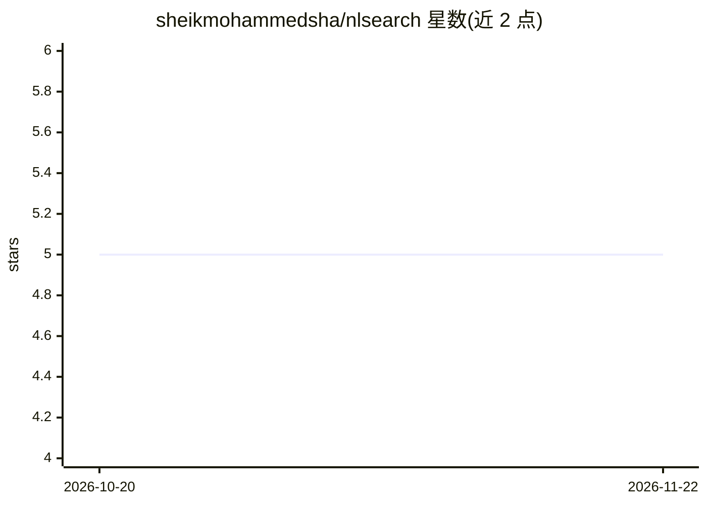

# sheikmohammedsha/nlsearch

⭐ 5 · Java · Apache-2.0 · 推送 2026-10-15 · [GitHub](https://github.com/sheikmohammedsha/nlsearch) · [官网](https://sheikmohammedsha.github.io/nlsearch/) · 个人维护

**Elasticsearch 插件：用自然语言执行搜索、增删改和映射操作**

以 Elasticsearch 插件形式提供 `_nl` 端点：把一句话交给语言模型转成对应的 Elasticsearch 调用并执行，返回人类可读的回答与原始响应两部分。支持搜索、增删文档、按查询删除、建删索引、修改 mapping；`session` 维护多轮对话历史，供聊天机器人追问。通过 `/_nl/analyze` 自动采样数据并为 keyword 字段生成含义说明。插件版本与 Elasticsearch 9.5.5 精确绑定，默认使用本地 Ollama。

## 筛选速览

| 维度 | 判定 | 备注 |
|---|---|---|
| AI 角色 | `ai-native` | 本体是模型或模型工具 |
| 许可风险 | `permissive` | Apache-2.0 |
| 部署形态 | `desktop` | 安装包/桌面程序 |
| 模型依赖 | local-ok | 支持本地模型 |
| 硬件要求 | — | 无带数字的原话,不猜 |
| 安装摩擦 | `medium` | 含编译或系统依赖之一 |
| 成熟度 | — | 结构信号不足 |

## 能力要点

- 单一 `_nl` 端点支持搜索、增删改、建删索引与 mapping 变更
- session 会话历史存入系统索引，支持追问、自我纠错与完整审计
- _nl/analyze 自动解码字段代码含义（如 dept=FW/AP/EQ）
- 默认 Ollama 本地模型，兼容任何 OpenAI 兼容 API

## 适用场景

- 让聊天机器人通过一个端点用自然语言查改 Elasticsearch 数据
- 运营人员用英语完成商品检索、折扣批量更新等操作
- 对话式追问："只看有货的"、"最便宜的排前面"

## 场景标签

`聊天机器人` `数据分析` · 领域:效率与自动化

## 证据(README 行号)

> L12: nlsearch is an Elasticsearch plugin that adds one endpoint, `_nl`. You send it a
> L14: Elasticsearch call, runs that call, and hands you back the result together with
> L35: It is made for chat bots: a single endpoint, no index name in the url, and an

## 星数曲线

2026-10-20 5 → 2026-11-22 5（+0）

---
*卡片 v1 · prompt 1.4 · 生成 2026-11-21 · 置信度 high · 依据 README sha `c1e68b4ee846` · [字段定义](../../DATASET.md)*
