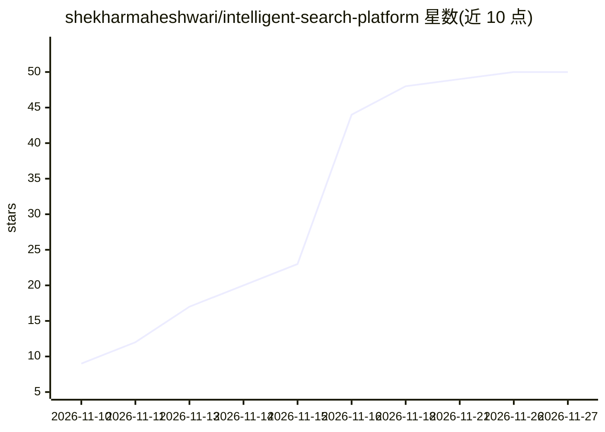

# shekharmaheshwari/intelligent-search-platform

⭐ 50 · Python · Apache-2.0 · 推送 2026-11-23 · [GitHub](https://github.com/shekharmaheshwari/intelligent-search-platform) · [官网](https://shekharmaheshwari.github.io/intelligent-search-platform/) · 个人维护

**自托管混合搜索后端：索引内容并提供词法+语义检索**

自包含的搜索后端：从 REST API、sitemap 和 Google Sheets 抓取内容写入 Typesense，用可插拔模型生成向量嵌入（默认 Voyage AI，可选 OpenAI 等兼容端点），通过 RRF 融合 BM25 词法与语义结果，并叠加编辑加权信号。附带 Svelte 管理 UI、运行于 V8 隔离的 JavaScript 扩展管道、面向商品列表页的目录 API（标签意图分类、跨集合搜索、分面、自动补全），以及基于点击/曝光日志的流行度自动加权。面向构建商品搜索的开发者，通过 ./deploy-all.sh 启动全部服务。

## 筛选速览

| 维度 | 判定 | 备注 |
|---|---|---|
| AI 角色 | `ai-native` | 本体是模型或模型工具 |
| 许可风险 | `permissive` | Apache-2.0 |
| 部署形态 | `self-host` | docker 或自建部署 |
| 模型依赖 | — | README 未给出锁定关系 |
| 硬件要求 | — | 无带数字的原话,不猜 |
| 安装摩擦 | `low` | 无编译、无系统依赖或容器化 |
| 成熟度 | — | 结构信号不足 |

## 能力要点

- BM25 + 语义结果经 RRF 融合（0.7/0.3 权重），叠加四类编辑加权信号
- 索引前可在 PyMiniRacer V8 隔离中链式执行 JavaScript transform 扩展
- 记录曝光与点击事件自动计算流行度并写回 Typesense，无需重建索引
- 标签意图检测读取 intent_label，无硬编码关键词

## 适用场景

- 为电商目录搭建带语义检索的商品搜索与 PLP 页面
- 从 REST API、sitemap 或 Google Sheets 同步并索引商品内容
- 通过查询加权与流行度信号做搜索结果运营调序

## 场景标签

`语义搜索` · 领域:知识与检索

## 证据(README 行号)

> L11: A self-contained search backend that indexes content from REST APIs and sitemaps into Typesense, generates vector e
> L99: ## Hybrid Search

## 星数曲线

2026-11-10 9 → 2026-11-27 50（+41）

---
*卡片 v1 · prompt 1.4 · 生成 2026-11-18 · 置信度 mid · 依据 README sha `a7381a353e95` · [字段定义](../../DATASET.md)*
