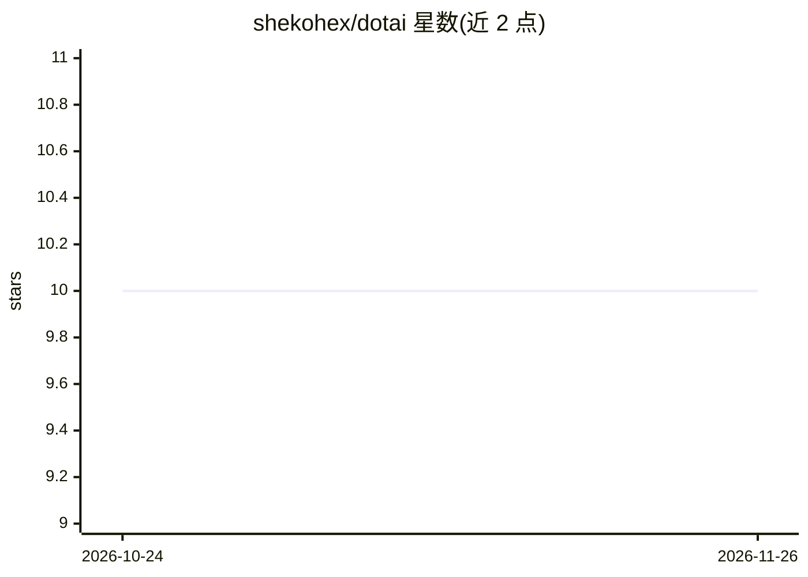

# shekohex/dotai

⭐ 10 · TypeScript · 推送 2026-10-25 · [GitHub](https://github.com/shekohex/dotai) · 个人维护

**为多套 AI 开发工具统一同步配置与指令的脚本系统**

以 Shell 脚本实现的配置管理系统：将统一的 AI.md 指令同步为各工具的指令文件，把 mcp.json 中的 MCP 服务器配置转换并写入 OpenCode 格式，同步 skills 目录到目标位置。覆盖 Unix 与 Windows，写文件前以 git diff（可回退到 diff）展示变更并请求确认，自动创建带时间戳的备份；依赖 jq、bash/cmd 等命令行工具，可选 git 与 rsync 并带回退方案。

## 筛选速览

| 维度 | 判定 | 备注 |
|---|---|---|
| AI 角色 | `ai-ecosystem` | LLM/agent 周边工具 |
| 许可风险 | `none` | — |
| 部署形态 | `None` |  |
| 模型依赖 | — | README 未给出锁定关系 |
| 硬件要求 | — | 无带数字的原话,不猜 |
| 安装摩擦 | `low` | 无编译、无系统依赖或容器化 |
| 成熟度 | — | 结构信号不足 |

## 能力要点

- 统一 mcp.json 自动转换为 OpenCode 的 opencode.jsonc 格式
- diff 预览加确认机制，变更前自动时间戳备份
- 跨平台安装脚本（install.sh / install.bat），支持 WSL
- 可选依赖带回退：git 缺失回退 diff，rsync 缺失回退 cp

## 适用场景

- 在多台机器间保持 AI 开发工具的指令与 MCP 配置一致
- 更新 AI.md 或 mcp.json 后一键同步到各工具目录
- 修改配置前先查看差异并保留可恢复的备份

## 场景标签

 · 领域:开发工具/配置管理

## 证据(README 行号)

> L3: A unified configuration management system for AI tools including OpenCode. This repository synchronizes configuratio
> L11: - Synchronizing the general `AI.md` instructions to tool-specific files
> L12: - Synchronizing MCP server configurations from a unified `mcp.json` to tool-specific formats

## 星数曲线

2026-10-24 10 → 2026-11-26 10（+0）

---
*卡片 v1 · prompt 1.4 · 生成 2026-11-19 · 置信度 high · 依据 README sha `1153664ee070` · [字段定义](../../DATASET.md)*
