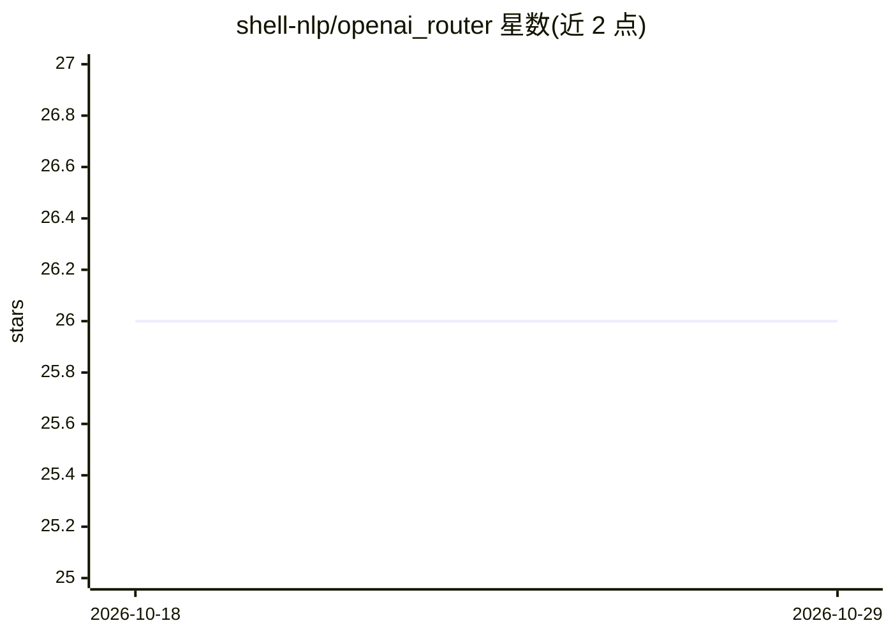

# shell-nlp/openai_router

⭐ 26 · Python · MIT · 推送 2026-07-19 · [GitHub](https://github.com/shell-nlp/openai_router) · 个人维护 · 中文 README

**给 LLM 应用开发者：聚合多家推理后端的统一 OpenAI API 网关**

面向使用 OpenAI 兼容接口的开发者：将 vLLM、SGLang、lmdeploy、Ollama 等不同后端聚合到同一 base_url 下转发，路由配置用 SQLite 零配置持久化。提供 Gradio Web UI 管理面板、同名模型多后端负载均衡（round_robin/consistent_hash）、模型级请求参数映射，以及用 Jinja2 模板渲染请求/响应日志（可查看原始提示词与思考过程）。限制：不提供独立管理鉴权体系，response_id 映射在进程重启后失效。支持 PyPI、Docker、源码三种安装方式。

## 筛选速览

| 维度 | 判定 | 备注 |
|---|---|---|
| AI 角色 | `ai-ecosystem` | LLM/agent 周边工具 |
| 许可风险 | `permissive` | MIT |
| 部署形态 | `self-host` | docker 或自建部署 |
| 模型依赖 | local-ok | 支持本地模型 |
| 硬件要求 | — | 无带数字的原话,不猜 |
| 安装摩擦 | `low` | 无编译、无系统依赖或容器化 |
| 成熟度 | — | 结构信号不足 |

## 能力要点

- 统一 base_url 聚合 vLLM/SGLang/lmdeploy/Ollama 等多后端
- 请求参数映射（模型级 key/value 字段搬运）
- Jinja2 渲染请求日志，可查看原始提示词与思考过程
- 同名模型多后端负载均衡（round_robin / consistent_hash）

## 适用场景

- 多个推理后端想用一个统一入口调用
- 调试 LLM 应用时查看模型收到的原始提示词和思考过程
- 老客户端字段与新后端结构不一致时在网关层做兼容

## 场景标签

`模型网关` · 领域:Agent 开发

## 证据(README 行号)

> L3:  轻量级、持久化、零配置的 OpenAI API 统一网关
> L11: - 将不同推理框架（vLLM、SGLang、lmdeploy、Ollama…）、不同 `Host`、不同 `Port` 的 OpenAI API 接口统一聚合到同一个 `base_url` 上，实现更便捷的模型调用。
> L18: |🧩 多后端|vLLM、SGLang、lmdeploy、Ollama… 任意组合|

## 星数曲线

2026-10-18 26 → 2026-10-29 26（+0）

---
*卡片 v1 · prompt 1.4 · 生成 2026-10-26 · 置信度 high · 依据 README sha `0bf896a98cd9` · [字段定义](../../DATASET.md)*
