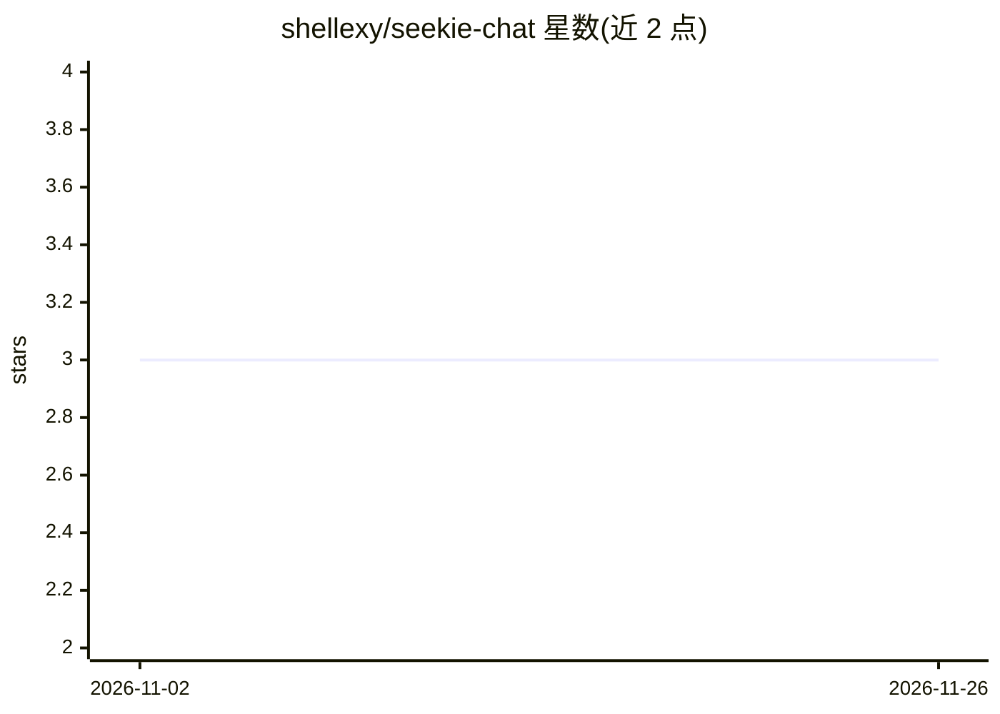

# shellexy/seekie-chat

⭐ 3 · TypeScript · MIT · 推送 2026-11-11 · [GitHub](https://github.com/shellexy/seekie-chat) · [官网](https://github.com/shellexy/seekie-chat) · 个人维护 · 中文 README

**Linux 桌面 LLM 聊天客户端：分支会话与请求详情可核对**

基于 Electron + React + TypeScript 的桌面 LLM 聊天客户端，聊天数据保存在本机。核心机制包括：从任意回答创建分支（各分支独立模型、提示词、温度）、推理/正文/工具调用分段的原位编辑、留存脱敏请求头与流式原文的请求详情页、token 用量统计与余额查询。支持四种 API 协议与多模态附件；通过 API Key 连接各模型服务，无内置模型。提供 deb/AppImage/Flatpak/安装包等产物，源码运行需 Node.js 24+。

## 筛选速览

| 维度 | 判定 | 备注 |
|---|---|---|
| AI 角色 | `ai-native` | 本体是模型或模型工具 |
| 许可风险 | `permissive` | MIT |
| 部署形态 | `desktop` | 安装包/桌面程序 |
| 模型依赖 | local-ok | 支持本地模型 |
| 硬件要求 | — | 无带数字的原话,不猜 |
| 安装摩擦 | `medium` | 含编译或系统依赖之一 |
| 成熟度 | — | 结构信号不足 |

## 能力要点

- 分支式会话：嵌套分支、上下文隔离、分支独立模型与提示词
- 多段正文编辑：推理与工具调用记录保持原位
- 请求详情可核到脱敏后的请求头、请求体与流式原文
- OpenAI Responses / Chat Completions / Anthropic / Gemini 四种协议适配

## 适用场景

- 在本地桌面与 DeepSeek 等多家模型服务聊天
- 对比不同分支的提示词与模型设置效果
- 排查 400/500 错误时核对发送到上游的原始请求
- 统计一段时间内各模型的 token 用量

## 场景标签

`聊天机器人` · 领域:对话与助手

## 证据(README 行号)

> L3: 跨平台桌面 LLM 聊天客户端（Linux / Windows / macOS）。Electron + React + TypeScript，默认浅色主题，聊天数据保存在本机。
> L27: - **分支是一等公民**：从任意回答开分支，每条分支有自己的模型、提示词、搜索与温度，互不干扰。
> L68: 1. 打开左下角设置，添加 OpenAI Responses、OpenAI Chat Completions、Anthropic、DeepSeek（Anthropic Messages）、Gemini、Ollama、Ollama 

## 星数曲线

2026-11-02 3 → 2026-11-26 3（+0）

---
*卡片 v1 · prompt 1.4 · 生成 2026-11-21 · 置信度 mid · 依据 README sha `e5dd15d4ac25` · [字段定义](../../DATASET.md)*
