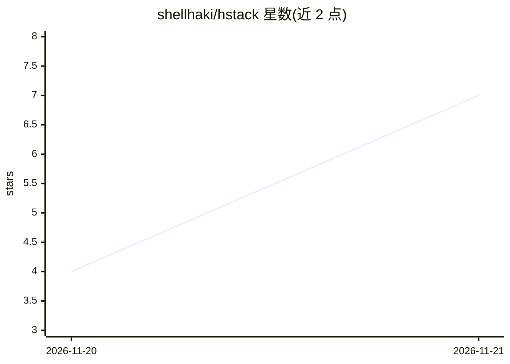

# shellhaki/hstack

⭐ 7 · TypeScript · MIT · 推送 2026-11-19 · [GitHub](https://github.com/shellhaki/hstack) · [官网](https://hstack.shellhaki.dev) · 个人维护

**让小模型写代码、前沿模型指挥的 agent 技能集**

hstack 是一组 agent 技能与 CLI 工具，将前沿模型用作高级工程师角色（撰写 intake、审批计划、在检查点下达简短指令、最终审查），小模型负责写规格、计划、测试和代码并自带独立审查者。事件驱动脚本在前沿模型等待时不消耗 token；lead 在独立 git worktree 中工作，经批准后才合并补丁。模型排序基于公开基准数据重排。当前仅支持 Muse Code harness，其他 agent 在路线图中。

## 筛选速览

| 维度 | 判定 | 备注 |
|---|---|---|
| AI 角色 | `ai-ecosystem` | LLM/agent 周边工具 |
| 许可风险 | `permissive` | MIT |
| 部署形态 | `library` | 以包/库形式分发 |
| 模型依赖 | — | README 未给出锁定关系 |
| 硬件要求 | — | 无带数字的原话,不猜 |
| 安装摩擦 | `low` | 无编译、无系统依赖或容器化 |
| 成熟度 | `idea` | |

## 能力要点

- 前沿模型与小模型分工：intake/审批 vs 规格/计划/测试/编码
- 事件驱动唤醒，等待检查点不消耗 token
- lead 在独立 git worktree 工作，批准后才应用补丁
- hstack-practice 技能向小模型注入工程实践（测试先行、状态表、安全基础）

## 适用场景

- 降低 agent 编码任务的 token 成本
- 让前沿模型把工程实现委派给小模型团队
- 需要检查点人工/模型审批的代码生成流程

## 场景标签

`编码 Agent` `代码生成` `代码审查` `Agent 框架` · 领域:Agent 开发

## 证据(README 行号)

> L5: hstack is a collection of agent skills that turns a frontier model into a senior engineer and a small, cheap model i
> L11: > Status: early. hstack currently runs on **Muse Code**: Muse Wonder as the frontier and Muse Spark as the small mo
> L58: 1. **Agent:** Muse Code for now. Claude Code, Cursor and OpenCode come later.

## 星数曲线

2026-11-20 4 → 2026-11-21 7（+3）

---
*卡片 v1 · prompt 1.4 · 生成 2026-11-21 · 置信度 high · 依据 README sha `0134d664136d` · [字段定义](../../DATASET.md)*
