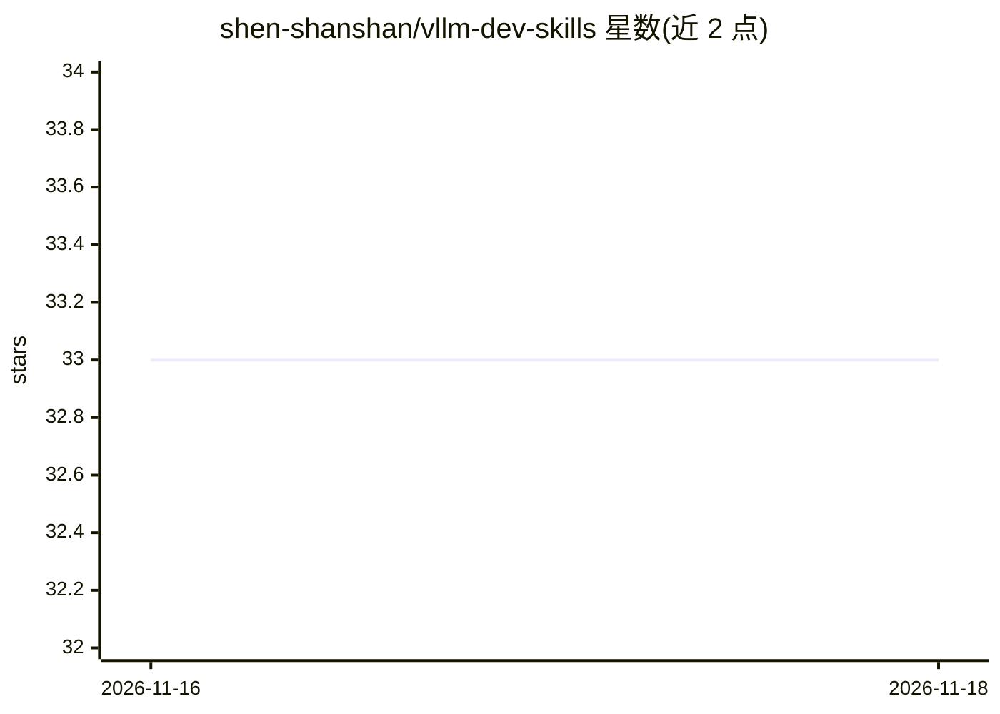

# shen-shanshan/vllm-dev-skills

⭐ 33 · Python · Apache-2.0 · 推送 2026-11-17 · [GitHub](https://github.com/shen-shanshan/vllm-dev-skills) · 个人维护 · 中文 README

**面向 vLLM 开发全流程的 Claude Code 技能集（17 个）**

由个人维护的 Claude Code agent 技能合集，覆盖 vLLM 开发生命周期：ROCm 环境初始化、贡献机会发现、特性/模型代码解读（生成中文技术文档）、特性设计与 RFC 生成、ROCm 代码实现、PR 描述/测试生成、benchmark 对比分析、trace 对比、PR 总结与 ROCm 专项 review、issue 分析与技术博客写作。每个技能以斜杠命令调用，需软链接到 Claude Code 官方技能目录使用；部分技能面向 AMD/ROCm 后端场景。

## 筛选速览

| 维度 | 判定 | 备注 |
|---|---|---|
| AI 角色 | `ai-knowledge` | 知识聚合/清单类 |
| 许可风险 | `permissive` | Apache-2.0 |
| 部署形态 | `self-host` | docker 或自建部署 |
| 模型依赖 | — | README 未给出锁定关系 |
| 硬件要求 | — | 无带数字的原话,不猜 |
| 安装摩擦 | `low` | 无编译、无系统依赖或容器化 |
| 成熟度 | — | 结构信号不足 |

## 能力要点

- 17 个覆盖环境搭建、代码阅读、贡献、性能分析、review 的 vLLM 开发技能
- vllm-rocm-env-prepare 在 nightly ROCm 容器内构建免编译 editable vLLM 环境
- vllm-rocm-pr-review 输出含 Mermaid 图、风险表与可复制英文评论的中文报告
- 技能通过软链接到 ~/.claude/skills 安装，兼容 Claude Code

## 适用场景

- vLLM 社区贡献者寻找可贡献的任务并生成 RFC/PR 描述
- 在 ROCm 容器中快速初始化 vLLM 开发环境
- 生成 vLLM 特性与模型的中文技术教程
- 对比 benchmark 与 kernel trace 分析性能差异

## 场景标签

`编码 Agent` `代码审查` · 领域:编码与开发

## 证据(README 行号)

> L5: A curated collection of Claude Code agent skills that accelerate the entire vLLM development lifecycle — from unders
> L9: |Name|Category|Description|Rec|

## 星数曲线

2026-11-16 33 → 2026-11-18 33（+0）

---
*卡片 v1 · prompt 1.4 · 生成 2026-11-18 · 置信度 mid · 依据 README sha `c0cfd07e0420` · [字段定义](../../DATASET.md)*
