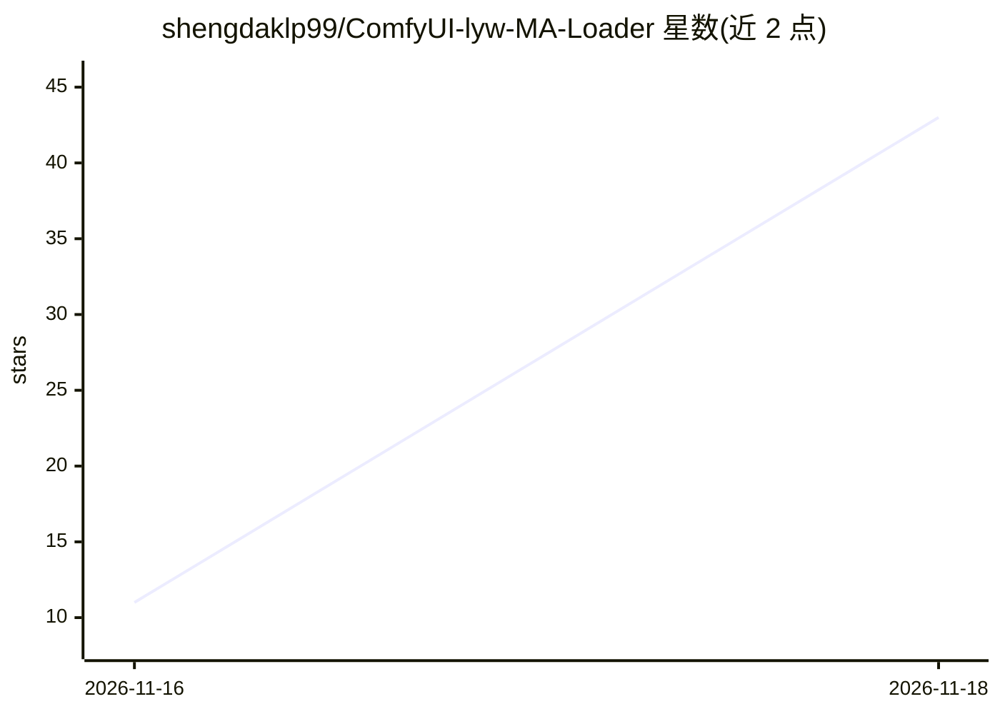

# shengdaklp99/ComfyUI-lyw-MA-Loader

⭐ 43 · JavaScript · 推送 2026-11-17 · [GitHub](https://github.com/shengdaklp99/ComfyUI-lyw-MA-Loader) · 个人维护 · 中文 README

**ComfyUI 的可视化 LoRA 加载节点：分组、预设与元数据管理**

ComfyUI 自定义节点，以可视化列表管理 LoRA：每个 LoRA 显示缩略图、权重滑条、备注与触发词按钮；支持文件夹分组、分组忽略、多选批量操作、预设与收藏拖拽插入。通过 SHA256 对 Civitai 解析触发词与预览图并保存为模型旁的 sidecar 文件；可选与 Lora Manager 复用同一数据格式与下载端点，未安装时回退自身爬取。支持节点链式连接，仅末端加载器对模型打补丁。

## 筛选速览

| 维度 | 判定 | 备注 |
|---|---|---|
| AI 角色 | `ai-ecosystem` | LLM/agent 周边工具 |
| 许可风险 | `none` | — |
| 部署形态 | `None` |  |
| 模型依赖 | — | README 未给出锁定关系 |
| 硬件要求 | — | 无带数字的原话,不猜 |
| 安装摩擦 | `low` | 无编译、无系统依赖或容器化 |
| 成熟度 | — | 结构信号不足 |

## 能力要点

- 可视化 LoRA 列表：缩略图、权重滑条、备注、触发词与启用开关
- Civitai 元数据按 SHA256 解析，批量填充并在限流时自动暂停
- 预设/收藏快照与多选批量操作（替换、复制、分组、取色）
- 可选集成 Lora Manager，无安装时独立运行

## 适用场景

- 在 ComfyUI 工作流中管理大量 LoRA 的启用与权重
- 为 LoRA 批量获取 Civitai 触发词和预览图
- 通过预设与收藏快速切换多 LoRA 组合

## 场景标签

`图像生成` · 领域:内容生成

## 证据(README 行号)

> L3: A standalone, visual LoRA loader node for ComfyUI — organize LoRAs into groups, manage presets and favorites, fetch 
> L27: lyw-MA Loader node
> L111: Restart ComfyUI. The node appears under **✨ Magic Assistant → lyw-MA Loader**.

## 星数曲线

2026-11-16 11 → 2026-11-18 43（+32）

---
*卡片 v1 · prompt 1.4 · 生成 2026-11-18 · 置信度 high · 依据 README sha `7d82476ae0b7` · [字段定义](../../DATASET.md)*
