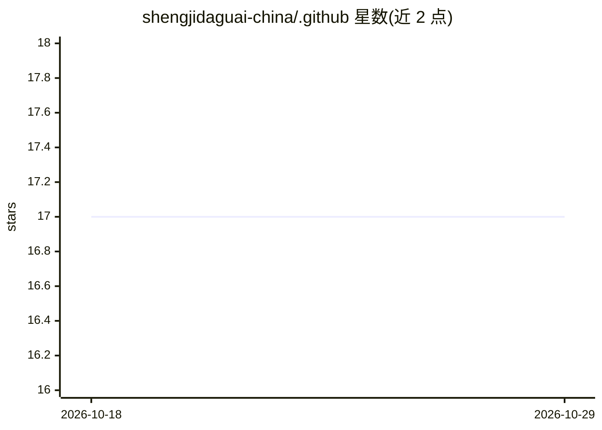

# shengjidaguai-china/.github

⭐ 17 · Python · 推送 2026-10-23 · [GitHub](https://github.com/shengjidaguai-china/.github) · 组织维护 · 中文 README

**面向非技术者的 AI 开源共建社区组织页**

一个 GitHub 组织的社区主页：面向普通人和非技术从业者，组织参与者借助 AI 把想法做成教程、工具和开源项目。提供 7 天新手教程、督促共学群、开源项目共建（代码/设计/测试/文档均可贡献）、维护者与正式成员机制，并列出首批开放共建项目（BossHunter、personal-homepage-skill、fitness-tracker 等）。通过微信群、QQ 和邮箱加入。本仓库为组织介绍页，不含可安装软件。

## 筛选速览

| 维度 | 判定 | 备注 |
|---|---|---|
| AI 角色 | `ai-knowledge` | 知识聚合/清单类 |
| 许可风险 | `none` | — |
| 部署形态 | `None` |  |
| 模型依赖 | — | README 未给出锁定关系 |
| 硬件要求 | — | 无带数字的原话,不猜 |
| 安装摩擦 | `low` | 无编译、无系统依赖或容器化 |
| 成熟度 | — | 结构信号不足 |

## 能力要点

- 7 天新手教程与督促共学活动
- 支持非代码贡献（产品/设计/测试/文档/推广）
- 项目可迁入社区或以合作项目方式收录
- 正式成员加入/退出与不活跃退出机制

## 适用场景

- 不会写代码的人借助 AI 完成第一个开源项目
- 从社区项目清单中挑小任务参与共建
- 申请成为社区项目维护者或正式成员

## 场景标签

 · 领域:开源社区/AI 科普教育

## 证据(README 行号)

> L5:  面向普通人和非技术从业者的 AI 开源共建社区。
> L7:  借助 AI，把自己的想法、经验和真实需求做成教程、工具和开源项目。

## 星数曲线

2026-10-18 17 → 2026-10-29 17（+0）

---
*卡片 v1 · prompt 1.4 · 生成 2026-10-29 · 置信度 mid · 依据 README sha `0e2d19917680` · [字段定义](../../DATASET.md)*
