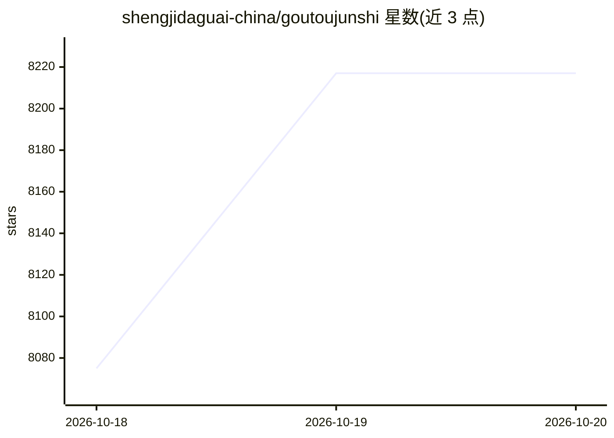

# shengjidaguai-china/goutoujunshi

⭐ 8,217 · Python · MIT · 推送 2026-09-20 · [GitHub](https://github.com/shengjidaguai-china/goutoujunshi) · 组织维护 · 中文 README

**面向个人用户的 AI 恋爱军师 Codex Skill：情绪支持加关系分析与行动策略**

一套安装到 Codex 类 AI 助手的恋爱咨询 Skill：先承接情绪，再建立本人与对象档案，区分事实、推测与未知，输出可直接发送的话术、行动方案与停止条件。内置覆盖关系心理学、性学、婚姻家庭、中国法律等领域的跨学科知识库（135 条参考资料，按证据强度分类），支持多元性取向与关系形态。可选 ChatLab 分析聊天导出文件、首次同意后启用跨任务长期记忆；不读取或解密聊天软件数据库，声明不替代心理治疗与法律医疗等专业服务。

## 筛选速览

| 维度 | 判定 | 备注 |
|---|---|---|
| AI 角色 | `ai-native` | 本体是模型或模型工具 |
| 许可风险 | `permissive` | MIT |
| 部署形态 | `None` |  |
| 模型依赖 | — | README 未给出锁定关系 |
| 硬件要求 | — | 无带数字的原话,不猜 |
| 安装摩擦 | `low` | 无编译、无系统依赖或容器化 |
| 成熟度 | — | 结构信号不足 |

## 能力要点

- 先情绪承接再输出可执行策略的分析流程，区分事实/推测/未知
- 跨学科知识库覆盖心理学、性学、法律、人文等 12 类领域，135 条参考资料按证据强度分类
- 支持多元性取向与关系形态，不预设性别角色
- 可选 ChatLab 聊天记录分析与首次同意后的长期记忆（可暂停/撤销/清空）

## 适用场景

- 不知道怎么回消息时获得可直接发送的话术与后续分支
- 追求、邀约、冲突、分手或复合时获得行动方案与观察窗口
- 长聊天记录/截图分析：锁定说话人并区分事实与推测
- 跨任务记住双方档案与关系进展，避免重复交代背景

## 场景标签

`AI 助手` `Agent 记忆` · 领域:Agent 开发

## 证据(README 行号)

> L10:  面向心动、暧昧、追求、冲突、分手与复合的 AI 恋爱军师，
> L21: 它不只是一个话术库。它能读取聊天截图、导出文本和用户转述，区分素材来源与事实边界；也能把分析落到一句可发送的话、一次具体邀约、第一次见面安排或一段可复盘的对话演练。它是一套覆盖恋爱全周期、面向多元关系、能够解释建议理由的 Code
> L102: 请使用狗头军师通过 ChatLab 分析我和对象A最近三个月的聊天。

## 星数曲线

2026-10-18 8,075 → 2026-10-20 8,217（+142）

---
*卡片 v1 · prompt 1.4 · 生成 2026-10-20 · 置信度 high · 依据 README sha `bb6abc698d23` · [字段定义](../../DATASET.md)*
