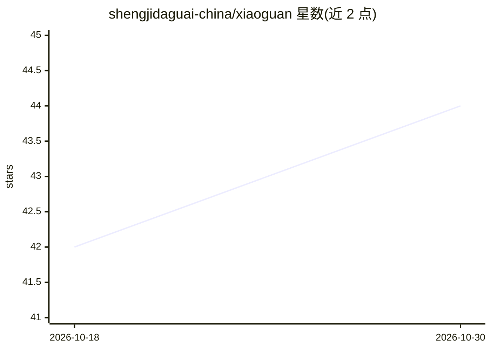

# shengjidaguai-china/xiaoguan

⭐ 44 · Python · NOASSERTION · 推送 2026-09-01 · [GitHub](https://github.com/shengjidaguai-china/xiaoguan) · 个人维护 · 中文 README

**面向 B 端销售的 Codex Skill：客户心理判断与成交策略助手**

以 Codex Skill 形式分发的销售决策助手（SKILL.md 路由），面向个人与 B 端销售者：先分析客户心理、显性与隐性需求、决策权重与核心阻力，再输出引导方向、证据任务与下一成交动作；默认不代写话术，仅在明确要求时生成对客表达。内置 204 项研究目录、403 份高相关资料的语料精简流程，提供可选的 SQLite 本地客户记忆（默认关闭）与 FTS5+向量混合 RAG 脚本，混合索引依赖本地 BAAI/bge 模型。采用 PolyForm Noncommercial 非商业许可，商业使用需另行授权。

## 筛选速览

| 维度 | 判定 | 备注 |
|---|---|---|
| AI 角色 | `ai-native` | 本体是模型或模型工具 |
| 许可风险 | `none` | NOASSERTION |
| 部署形态 | `None` |  |
| 模型依赖 | — | README 未给出锁定关系 |
| 硬件要求 | — | 无带数字的原话,不猜 |
| 安装摩擦 | `low` | 无编译、无系统依赖或容器化 |
| 成熟度 | — | 结构信号不足 |

## 能力要点

- SKILL.md 请求路由，按用户问题类型（画像/策略/跟进/谈判/代写）分流回答
- 本地客户记忆工具：事实/事件/假设分表存储，默认关闭且拒绝敏感字段
- 混合 RAG 脚本：FTS5 + 中英向量 + 销售阶段与来源等级重排，坚持本地模型
- 语料从 3448 万字符精简至 1680 万，保留 403 份资料、15,473 个分片

## 适用场景

- 销售在接触客户前判断其决策风格与核心顾虑
- 推进卡住的谈判：定位唯一高权重阻力并给解除标准
- 接入自己的行业知识库做销售检索辅助

## 场景标签

 · 领域:销售/商业决策辅助

## 证据(README 行号)

> L5:  面向个人与 B 端销售的本地客户军师：先判断客户心理、需求与决策权重，再给引导方向和下一成交动作。
> L146: ├── SKILL.md                         # 主入口、请求路由与输出规则

## 星数曲线

2026-10-18 42 → 2026-10-30 44（+2）

---
*卡片 v1 · prompt 1.4 · 生成 2026-10-25 · 置信度 high · 依据 README sha `b1ac02e487be` · [字段定义](../../DATASET.md)*
