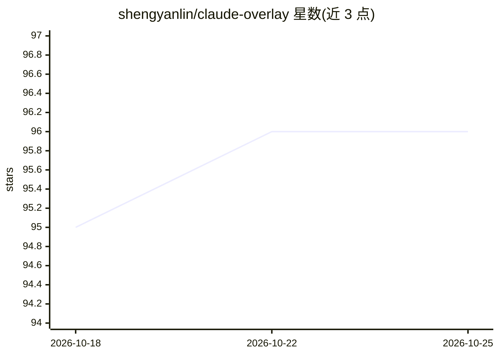

# shengyanlin/claude-overlay

⭐ 96 · Python · MIT · 推送 2026-10-24 · [GitHub](https://github.com/shengyanlin/claude-overlay) · 个人维护

**Windows 屏幕感知悬浮 Claude Code 聊天窗，用自有订阅**

基于 Tkinter 的无边框置顶悬浮窗，通过 claude-agent-sdk 启动本地已安装的 claude CLI 子进程与 Anthropic 通信，使用用户现有 Claude 订阅登录、无需 API key。每条消息自动用 Pillow ImageGrab 逐显示器截图并标注主副屏，由 Claude 的 Read 工具读取；可编辑当前打开的文档（如经 PowerShell/COM 驱动 PowerPoint/Excel），支持多实例命名、会话恢复、图片与 PDF 附件。仅支持 Windows 10/11，需 Python 3.10+ 与已登录的 Claude Code CLI，提供 setup.cmd 一键安装。

## 筛选速览

| 维度 | 判定 | 备注 |
|---|---|---|
| AI 角色 | `ai-native` | 本体是模型或模型工具 |
| 许可风险 | `permissive` | MIT |
| 部署形态 | `desktop` | 安装包/桌面程序 |
| 模型依赖 | locked-api |  |
| 硬件要求 | — | 无带数字的原话,不猜 |
| 安装摩擦 | `low` | 无编译、无系统依赖或容器化 |
| 成熟度 | — | 结构信号不足 |

## 能力要点

- 悬浮窗自动逐显示器截图，Claude 直接读取屏幕内容作答
- 驱动本机 claude CLI 登录，使用现有订阅，无需 API key
- 可对屏幕上打开的文件执行编辑/命令（如 PowerShell/COM 操作 Office）
- 多实例命名、会话重启恢复、启动时自动检查更新

## 适用场景

- 不切窗口直接对屏幕上的报错、文档、表格提问
- 让 Claude 直接修改当前打开的幻灯片或 Excel 文件
- 全屏演示或通话时临时唤起悬浮助手查证内容

## 场景标签

`AI 助手` · 领域:对话与助手

## 证据(README 行号)

> L112: Overlay (Tkinter UI)  →  claude-agent-sdk  →  spawns the `claude` CLI  →  Anthropic
> L117: - **Brain** — `claude-agent-sdk` spawns your installed `claude` CLI as a subprocess
> L119: - **Eyes** — Pillow `ImageGrab` snapshots **each monitor separately**; the prompt

## 星数曲线

2026-10-18 95 → 2026-10-25 96（+1）

---
*卡片 v1 · prompt 1.4 · 生成 2026-10-23 · 置信度 mid · 依据 README sha `f13f2b95f0f4` · [字段定义](../../DATASET.md)*
