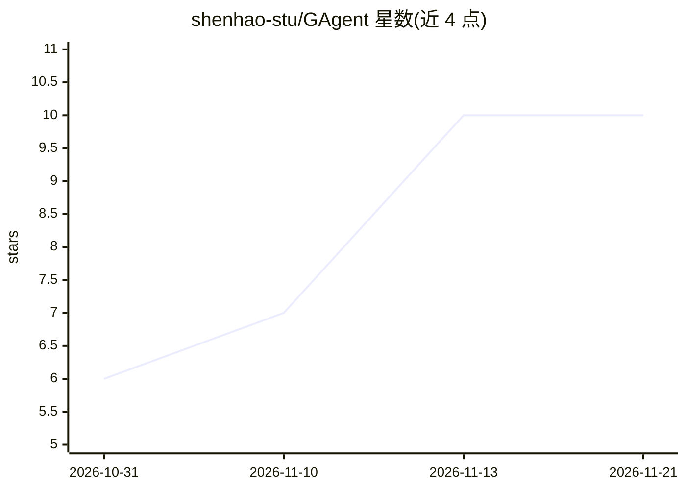

# shenhao-stu/GAgent

⭐ 10 · Python · Apache-2.0 · 推送 2026-11-09 · [GitHub](https://github.com/shenhao-stu/GAgent) · [官网](https://gaagent.ai/) · 个人维护 · 中文 README

**手机上的自进化 Android 屏幕操作 Agent，BYOK 接模型**

将 GenericAgent 的极简自进化 agent 架构移植到 Android：观察屏幕、执行本地 Python、操作文件与网页，并把验证过的经验存为可复用流程。核心机制包括本地 OCR 与可选 YOLOv8n（21 类 UI 控件检测）、无线自ADB（免 Shizuku）、会话保持浏览器、分层记忆按需召回。Agent 与工具在手机端运行，模型端点由用户自行配置（需自备 API URL/key/model ID），日常使用无需电脑。发布为 prerelease，物理验证仅覆盖 Pixel 10 与 MEIZU 21。

## 筛选速览

| 维度 | 判定 | 备注 |
|---|---|---|
| AI 角色 | `ai-native` | 本体是模型或模型工具 |
| 许可风险 | `permissive` | Apache-2.0 |
| 部署形态 | `None` |  |
| 模型依赖 | — | README 未给出锁定关系 |
| 硬件要求 | — | 无带数字的原话,不猜 |
| 安装摩擦 | `low` | 无编译、无系统依赖或容器化 |
| 成熟度 | — | 结构信号不足 |

## 能力要点

- 观察→行动→验证→存流程的记忆循环，验证过的经验跨会话复用
- 本地 OCR + 可选 YOLOv8n 定位 21 类 Android UI 控件，视觉理解可调图像模型
- 通过 Android 无线调试实现 Self-ADB，无需 Shizuku 或 root
- 离线语音输入与跨设备 PC Link/P2P 连接

## 适用场景

- 让 Agent 按目标自动操作手机应用完成查找、排序、读取等任务
- 通过保留登录态的后台浏览器执行网页任务并保存摘要
- 描述小应用并经 APK Factory 生成和取回 APK
- 手机与配对电脑协作完成跨设备读取与处理

## 场景标签

`GUI 自动化` `浏览器自动化` `代码生成` · 领域:效率与自动化

## 证据(README 行号)

> L10: **GAgent brings GenericAgent's minimal, self-evolving autonomous-agent design to Android.**
> L13: procedures. The agent and tools run on your phone; you choose the model endpoint.

## 星数曲线

2026-10-31 6 → 2026-11-21 10（+4）

---
*卡片 v1 · prompt 1.4 · 生成 2026-11-19 · 置信度 high · 依据 README sha `a11a0f041624` · [字段定义](../../DATASET.md)*
