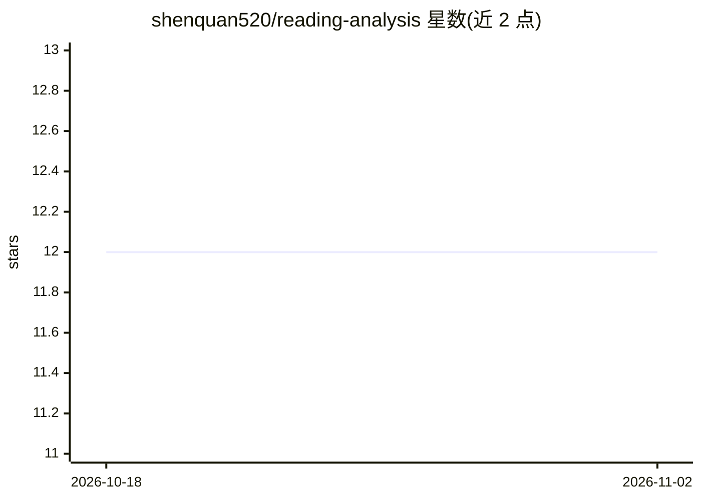

# shenquan520/reading-analysis

⭐ 12 · Python · NOASSERTION · 推送 2026-10-31 · [GitHub](https://github.com/shenquan520/reading-analysis) · 个人维护 · 中文 README

**英语考试阅读题的 AI 分析方法卡体系，供 AI 读取执行**

面向高考/四六级/考研英语阅读的自学分析工具：提供 136 张方法卡（题型映射、干扰项归因、步骤指引），以 SKILL.md 规则包 + references/ 卡库形式供 AI 读取，生成带篇章结构、段旨、逐题解析（正确项依据 + 干扰项归因）、长难句剥离的「阅读解析版」。支持三种接入方式：粘贴到任意 AI 对话框、装成 Claude Code/WorkBuddy 等 skill、挂成 RAG 知识库。附一个 Python 3.8+ 仅标准库的 HTML 渲染脚本（可选，无 Python 时 AI 手写 HTML 兜底）。仓库不含真题内容，theories/cases 目录留空由用户填充。

## 筛选速览

| 维度 | 判定 | 备注 |
|---|---|---|
| AI 角色 | `ai-knowledge` | 知识聚合/清单类 |
| 许可风险 | `none` | NOASSERTION |
| 部署形态 | `None` |  |
| 模型依赖 | — | README 未给出锁定关系 |
| 硬件要求 | — | 无带数字的原话,不猜 |
| 安装摩擦 | `low` | 无编译、无系统依赖或容器化 |
| 成熟度 | — | 结构信号不足 |

## 能力要点

- 136 张可操作方法卡，覆盖题型映射与干扰项归因
- 三种接入方式：网页对话粘贴 / skill 安装 / RAG 知识库
- 对抗式模式：AI 先闭卷作答再与用户答案对撞
- 批量跑 5-10 篇生成五行摘要与错因统计复盘

## 适用场景

- 没有老师指导时自己分析英语阅读错题的归因
- 让 AI 按固定方法论拆解整篇阅读文章
- 批量复盘多篇阅读并统计个人错因分布

## 场景标签

`教程课程` · 领域:学习与行业

## 证据(README 行号)

> L11: 本项目解决的就是这个：把阅读分析拆成 **136 张**可操作的方法卡。每个选项都有归因（错在哪类陷阱）、有原理（为什么这样判）、有步骤（下一步怎么做）。错了知道为什么错，对了知道为什么对——相当于给自己配了一套不需要老师在场的分
> L70: SKILL.md 工作规则与工作流（AI 读这个）
> L78: 这个项目是**给 AI 读的规则包**，不是普通软件，所以装不上、用不明白、结果看着不对，都很正常。遇到就来说：

## 星数曲线

2026-10-18 12 → 2026-11-02 12（+0）

---
*卡片 v1 · prompt 1.4 · 生成 2026-11-01 · 置信度 high · 依据 README sha `4b3df5e7fdda` · [字段定义](../../DATASET.md)*
