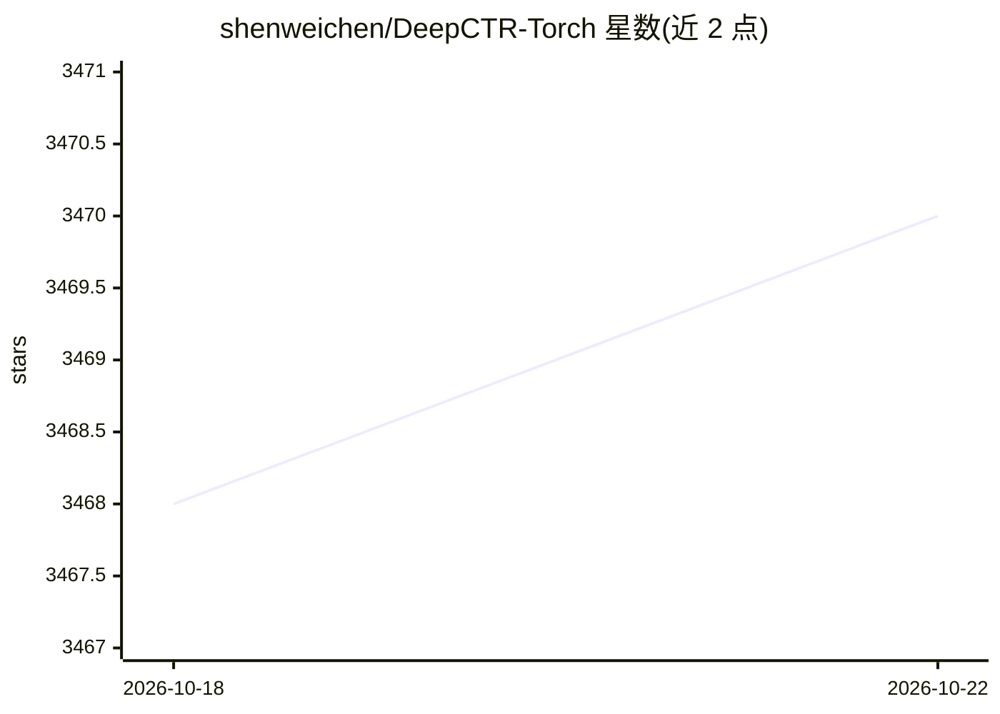

# shenweichen/DeepCTR-Torch

⭐ 3,470 · Python · Apache-2.0 · 推送 2026-07-09 · [GitHub](https://github.com/shenweichen/DeepCTR-Torch) · [官网](https://deepctr-torch.readthedocs.io/en/latest/index.html) · 个人维护 · 中文 README

**基于 PyTorch 的 CTR 预估深度学习模型库**

DeepCTR 的 PyTorch 版本：提供 20 余种基于深度学习的 CTR（点击率）预估模型实现，覆盖 CCP、PNN、Wide&Deep、DeepFM、xDeepFM、DIN、FiBiNET、DCN V2 等，并包含 AFM/NFM/DIFM 等变体与 ESMM/MMOE/PLE 等多任务模型，每项均标注对应论文。各模型统一以 model.fit()/model.predict() 接口调用，附带可复用的核心组件层供自定义模型搭建，通过 pip 安装。面向推荐系统与计算广告场景的开发者和研究人员。

## 筛选速览

| 维度 | 判定 | 备注 |
|---|---|---|
| AI 角色 | `ai-native` | 本体是模型或模型工具 |
| 许可风险 | `permissive` | Apache-2.0 |
| 部署形态 | `library` | 以包/库形式分发 |
| 模型依赖 | — | README 未给出锁定关系 |
| 硬件要求 | — | 无带数字的原话,不猜 |
| 安装摩擦 | `low` | 无编译、无系统依赖或容器化 |
| 成熟度 | — | 结构信号不足 |

## 能力要点

- 20+ 种 CTR 模型实现，逐项标注原始论文出处
- 统一 model.fit()/model.predict() 接口
- 提供核心组件层，可组合构建自定义模型
- 包含 ESMM/MMOE/PLE 等多任务学习模型

## 适用场景

- 快速基线对比多种 CTR 预估模型
- 在推荐或广告系统中复用特征交互组件层搭建自定义模型
- 按论文复现 DeepFM/xDeepFM/DIN 等经典结构

## 场景标签

`推荐系统` · 领域:学习与行业

## 证据(README 行号)

> L17: DeepCTR is a **Easy-to-use**,**Modular** and **Extendible** package of deep-learning based CTR models along with lo
> L29: |DeepFM|[IJCAI 2017]DeepFM: A Factorization-Machine based Neural Network for CTR Prediction|

## 星数曲线

2026-10-18 3,468 → 2026-10-22 3,470（+2）

---
*卡片 v1 · prompt 1.4 · 生成 2026-10-20 · 置信度 high · 依据 README sha `f495802baaf9` · [字段定义](../../DATASET.md)*
