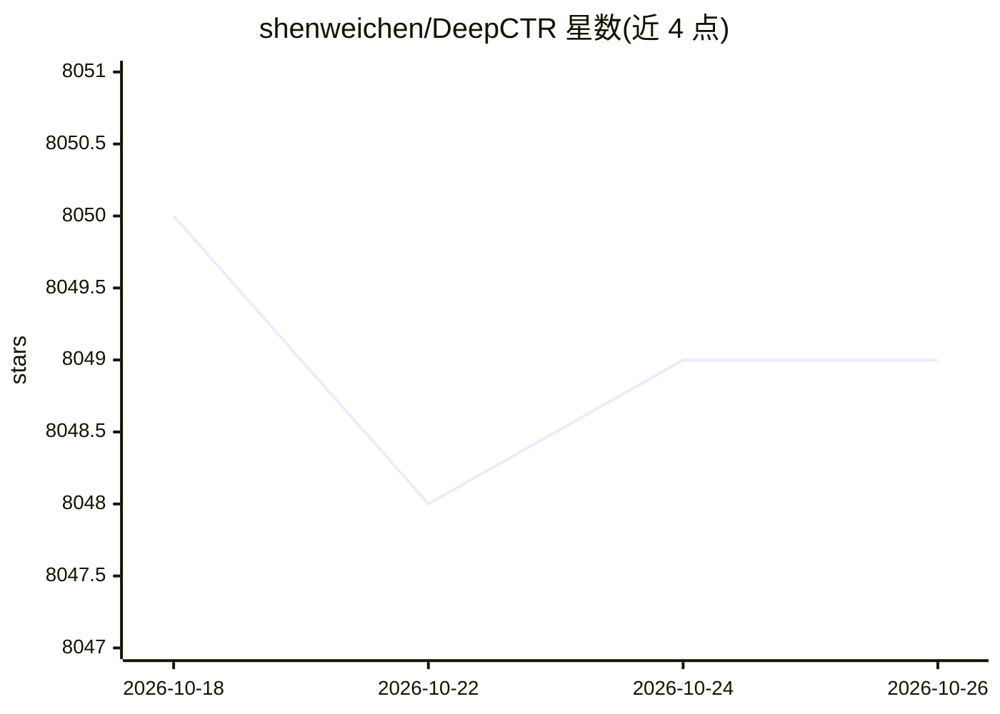

# shenweichen/DeepCTR

⭐ 8,049 · Python · Apache-2.0 · 推送 2026-10-11 · [GitHub](https://github.com/shenweichen/DeepCTR) · [官网](https://deepctr-doc.readthedocs.io/en/latest/index.html) · 个人维护 · 中文 README

**基于深度学习的 CTR 预估模型库，含 29 种论文模型**

提供 29 种按论文实现的 CTR/多任务模型（DeepFM、DIN、DIEN、xDeepFM、AutoInt、ESMM、MMOE、PLE 等）及可复用组件层，用于快速搭建自定义模型。接口提供 tf.keras.Model 风格的 fit/predict 与 TensorFlow estimator（面向大规模数据分布式训练），兼容 tf 1.15 与 2.x。不自动安装 TensorFlow，需用户先安装匹配环境的 TensorFlow。主要贡献者来自 Alibaba、Amazon、ByteDance 等。

## 筛选速览

| 维度 | 判定 | 备注 |
|---|---|---|
| AI 角色 | `ai-native` | 本体是模型或模型工具 |
| 许可风险 | `permissive` | Apache-2.0 |
| 部署形态 | `library` | 以包/库形式分发 |
| 模型依赖 | — | README 未给出锁定关系 |
| 硬件要求 | — | 无带数字的原话,不猜 |
| 安装摩擦 | `low` | 无编译、无系统依赖或容器化 |
| 成熟度 | — | 结构信号不足 |

## 能力要点

- 29 种论文来源的 CTR/多任务模型实现
- tf.keras.Model 风格接口与 TensorFlow estimator 分布式训练接口
- 兼容 tf 1.15 与 tf 2.x
- 提供可复用的核心组件层用于构建自定义模型

## 适用场景

- 快速实验对比各类 CTR 预估模型
- 广告/推荐场景做点击率与转化率预估
- 复用组件层搭建自定义 CTR 模型

## 场景标签

`推荐系统` · 领域:学习与行业

## 证据(README 行号)

> L18: DeepCTR is a **Easy-to-use**, **Modular** and **Extendible** package of deep-learning based CTR models along with l
> L22: - Provide `tf.keras.Model` like interfaces for **quick experiment**. example

## 星数曲线

2026-10-18 8,050 → 2026-10-26 8,049（-1）

---
*卡片 v1 · prompt 1.4 · 生成 2026-10-20 · 置信度 high · 依据 README sha `5e506cb1e3f6` · [字段定义](../../DATASET.md)*
