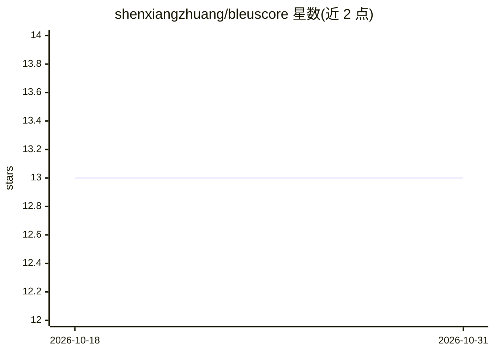

# shenxiangzhuang/bleuscore

⭐ 13 · Rust · MIT · 推送 2026-10-01 · [GitHub](https://github.com/shenxiangzhuang/bleuscore) · [官网](http://mathewshen.me/bleuscore/) · 个人维护

**Rust 实现的 BLEU 分数计算库，提供 Python 绑定**

用 Rust 编写的 BLEU 分数计算器，通过 PyO3/maturin 打包为 Python 包发布于 PyPI，同时也发布到 Crates.io 与 npm。用法与 Hugging Face evaluate 库一致，可替换 import 直接使用。README 报告在语料规模超过 100K 时取得 10 倍以上加速的基准结果，基准源码位于 benchmark/simple 目录，并提供网页 demo 供在线试用。MIT 许可。

## 筛选速览

| 维度 | 判定 | 备注 |
|---|---|---|
| AI 角色 | `ai-ecosystem` | LLM/agent 周边工具 |
| 许可风险 | `permissive` | MIT |
| 部署形态 | `library` | 以包/库形式分发 |
| 模型依赖 | — | README 未给出锁定关系 |
| 硬件要求 | — | 无带数字的原话,不猜 |
| 安装摩擦 | `low` | 无编译、无系统依赖或容器化 |
| 成熟度 | — | 结构信号不足 |

## 能力要点

- Rust 实现的 BLEU 分数计算，Python 包发布于 PyPI
- 用法与 Hugging Face evaluate 保持一致，可替换 import 使用
- 基准显示语料超过 100K 时取得 10 倍以上加速
- 同时发布于 Crates.io 与 npm，并提供网页 demo

## 适用场景

- 机器翻译/文本生成系统的 BLEU 指标评测
- 大规模语料场景下加速 BLEU 计算
- 作为 Hugging Face evaluate 的直接替换使用

## 场景标签

`模型评测` · 领域:评测与运维

## 证据(README 行号)

> L11: `bleuscore`
> L22: The usage is exactly same with huggingface evaluate:

## 星数曲线

2026-10-18 13 → 2026-10-31 13（+0）

---
*卡片 v1 · prompt 1.4 · 生成 2026-10-31 · 置信度 high · 依据 README sha `fe21c6ba6a0a` · [字段定义](../../DATASET.md)*
