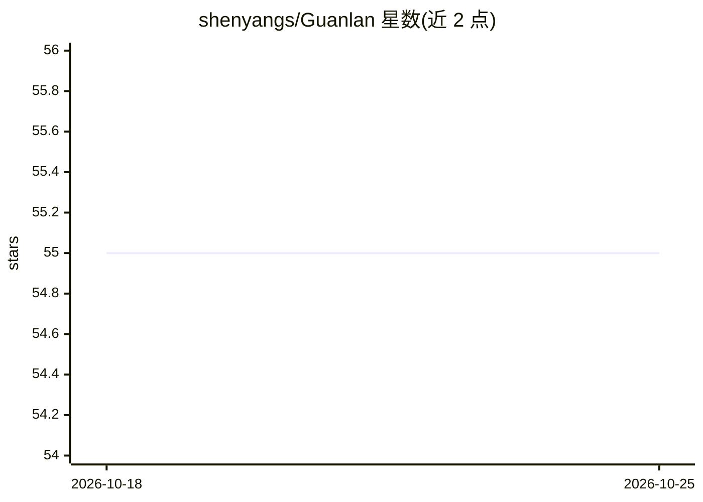

# shenyangs/Guanlan

⭐ 55 · Python · MIT · 推送 2026-08-30 · [GitHub](https://github.com/shenyangs/Guanlan) · [官网](https://Guanlan.xin) · 个人维护 · 中文 README

**给 AI Agent 的中文互联网研究与信源路由 CLI 工具**

面向 AI Agent 的 CLI 工具，提供中文网页搜索、信源路由（政策/口碑/技术/产业分流）、网页转 Markdown 阅读、热榜观察、股票财经结构化入口与证据包输出；research 命令返回 evidence_bundle_v1，Archive 保留可回查快照，case 支持可暂停恢复的研究任务，watch 固化长期意图。默认只读、明源，不读取 Cookie 等私密数据。Python 3.10+，经 uv/pipx/Homebrew 安装，当前为 Alpha 阶段，部分平台能力为 opt-in/experimental。

## 筛选速览

| 维度 | 判定 | 备注 |
|---|---|---|
| AI 角色 | `ai-ecosystem` | LLM/agent 周边工具 |
| 许可风险 | `permissive` | MIT |
| 部署形态 | `library` | 以包/库形式分发 |
| 模型依赖 | — | README 未给出锁定关系 |
| 硬件要求 | — | 无带数字的原话,不猜 |
| 安装摩擦 | `low` | 无编译、无系统依赖或容器化 |
| 成熟度 | `idea` | |

## 能力要点

- 信源路由：按主题类型分流到官方源、社区、RSS、垂类媒体
- research --format json 增量返回 evidence_bundle_v1 证据来源链
- case 可恢复研究任务与 watch 长期意图雷达
- 默认只读安全边界：不读 Cookie/登录态，不自动互动

## 适用场景

- 让 Agent 做中文互联网研究时获得可追溯的证据上下文
- 观察中文热榜与 RSS 感知当日热点
- 长周期课题固化 standing intent 持续发现新线索

## 场景标签

`科研工具` `网页抓取` · 领域:效率与自动化

## 证据(README 行号)

> L29: 观澜不是“又一个搜索 CLI”，而是给 AI Agent 用的中文互联网研究底座：它会先判断该去哪里找，再把网页、热榜、RSS、官方源、垂类媒体和社区样本整理成可追溯的证据上下文。
> L43: 2. **信源路由**：政策看官方和党央媒，口碑看社区样本，技术看开发者与 RSS，产业看垂类媒体。

## 星数曲线

2026-10-18 55 → 2026-10-25 55（+0）

---
*卡片 v1 · prompt 1.4 · 生成 2026-10-24 · 置信度 mid · 依据 README sha `be123096f5e7` · [字段定义](../../DATASET.md)*
