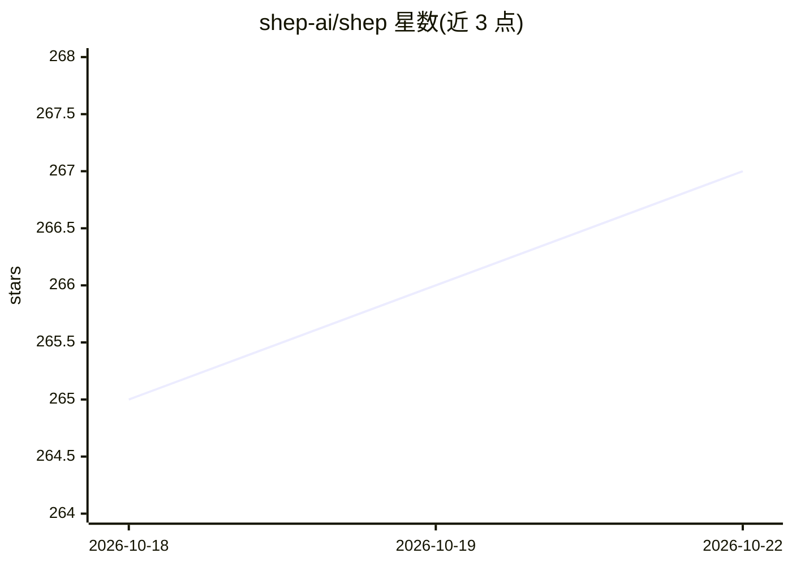

# shep-ai/shep

⭐ 267 · TypeScript · MIT · 推送 2026-10-19 · [GitHub](https://github.com/shep-ai/shep) · [官网](https://shep.bot) · 组织维护

**并行编排多个 AI 编码 agent、自动产出 PR 的开源编排器**

面向开发者的本地优先 agent 编排 CLI：把一行功能描述驱动为规格门（可选）、实现、提交、推送、CI 监视自动修复与草稿 PR。每个功能在独立 git worktree 中运行，支持 Claude Code、Codex CLI、Cursor CLI、Gemini CLI、Ollama 等十余种 agent/后端，可按功能随时切换。提供 localhost:4050 网页控制中心，数据以 SQLite 存于本地。默认对 agent 传入绕过权限标志，依赖 worktree 隔离、草稿 PR 与用户 CI 三层防护；默认开启可关闭的用量遥测。

## 筛选速览

| 维度 | 判定 | 备注 |
|---|---|---|
| AI 角色 | `ai-ecosystem` | LLM/agent 周边工具 |
| 许可风险 | `permissive` | MIT |
| 部署形态 | `library` | 以包/库形式分发 |
| 模型依赖 | local-ok | 支持本地模型 |
| 硬件要求 | — | 无带数字的原话,不猜 |
| 安装摩擦 | `low` | 无编译、无系统依赖或容器化 |
| 成熟度 | — | 结构信号不足 |

## 能力要点

- 每功能独立 git worktree，并行多 agent 无分支冲突
- CI 失败自动读日志修复（默认 3 次重试），不合并未过 CI 的代码
- 内置 7 种 agent CLI 与 OpenRouter/Together/Ollama/LLM Proxy 等 HTTP 后端
- 可选 spec 驱动流水线：需求/研究/计划为 YAML 工件并带审批门

## 适用场景

- 同时推进多个功能请求，各自生成草稿 PR 统一审查
- 从一句话描述新建应用骨架再持续加功能
- 为已有仓库挂接任意 agent CLI 跑自动化开发流程

## 场景标签

 · 领域:开发工具/AI 编码编排

## 证据(README 行号)

> L12: Shep is the open-source orchestrator for the autonomous development cycle. It runs parallel AI agents — Claude Code
> L70: |Agent|Binary|Support|
> L81: |Ollama|— (local HTTP)|Built-in — runs models locally|

## 星数曲线

2026-10-18 265 → 2026-10-22 267（+2）

---
*卡片 v1 · prompt 1.4 · 生成 2026-10-22 · 置信度 high · 依据 README sha `98cca11a7393` · [字段定义](../../DATASET.md)*
