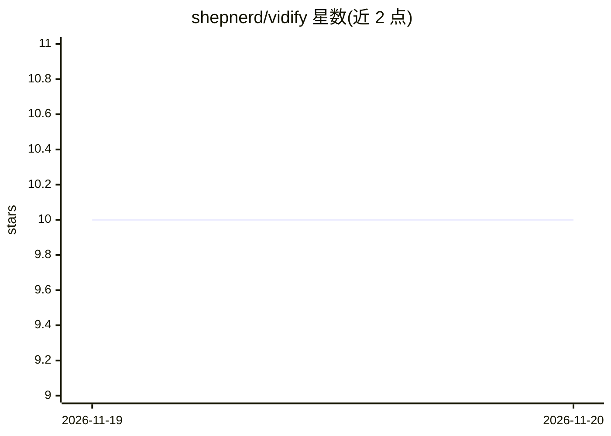

# shepnerd/vidify

⭐ 10 · Python · Apache-2.0 · 推送 2026-07-15 · [GitHub](https://github.com/shepnerd/vidify) · 个人维护 · 中文 README

**视频理解 agent：把视频转为时间线、问答、报告与片段**

Vidify 是一个 ASR 优先的视频理解 agent，输入 YouTube URL、HTTP 视频或本地文件，输出结构化分析、可检索索引（FAISS）、证据支撑的问答、高光片段导出与报告，并支持网络摄像头/RTMP 直播流的分段理解与实时问答。分层架构：入口、核心编排器、可组合 workflow 与 skill、模型适配器、缓存输出。转写覆盖率足够时跳过视觉模型调用。依赖 OpenAI 兼容多模态端点（通常为 vLLM 服务 Qwen3.5），提供 CLI、FastAPI REST API 与 Web UI。

## 筛选速览

| 维度 | 判定 | 备注 |
|---|---|---|
| AI 角色 | `ai-native` | 本体是模型或模型工具 |
| 许可风险 | `permissive` | Apache-2.0 |
| 部署形态 | `library` | 以包/库形式分发 |
| 模型依赖 | local-ok | 支持本地模型 |
| 硬件要求 | — | 无带数字的原话,不猜 |
| 安装摩擦 | `medium` | 含编译或系统依赖之一 |
| 成熟度 | — | 结构信号不足 |

## 能力要点

- ASR-first 流水线：转写覆盖充分时跳过视觉模型调用
- FAISS 索引支撑对视频转写、帧与元数据的问答
- 支持 YouTube、本地文件、webcam/RTMP 直播流输入
- 提供 brief/detailed/ask/highlights/report/live 六种工作流模式

## 适用场景

- 把 YouTube 视频转成结构化时间线与报告
- 对已索引视频做带证据的问答
- 从直播流中提取片段并实时提问
- 导出视频高光片段或集锦

## 场景标签

`RAG` `语音识别` `多模态` · 领域:知识与检索

## 证据(README 行号)

> L5: Vidify is a video understanding agent. Give it a YouTube URL, HTTP video URL, or
> L22: |Search & Ask|Build a FAISS index over transcript, frames, and metadata for evidence-backed Q&A|
> L77: Vidify expects an OpenAI-compatible multimodal endpoint, usually vLLM:

## 星数曲线

2026-11-19 10 → 2026-11-20 10（+0）

---
*卡片 v1 · prompt 1.4 · 生成 2026-11-19 · 置信度 high · 依据 README sha `d696ec34839e` · [字段定义](../../DATASET.md)*
