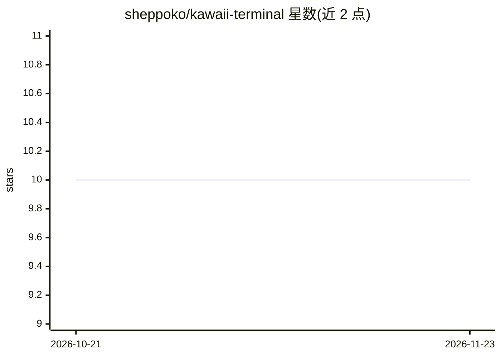

# sheppoko/kawaii-terminal

⭐ 10 · JavaScript · MIT · 推送 2026-03-15 · [GitHub](https://github.com/sheppoko/kawaii-terminal) · [官网](https://kawaii-terminal.dev/) · 个人维护

**为 Claude Code 与 Codex 提供会话记忆的终端**

一个把 AI 编码会话作为一等对象管理的终端应用：读取 Claude Code / Codex 的 agent JSONL 日志，将历史会话变为可搜索记录，并支持从会话中任意步骤回溯、分叉出新会话且保留相同上下文。保留多标签、分屏、SSH 等常规终端功能，不取代 IDE。提供 Windows/macOS 构建脚本与 GitHub Releases 下载，源码以 npm 运行。会话摘要为可选功能，需配置 Claude 或 Gemini provider。

## 筛选速览

| 维度 | 判定 | 备注 |
|---|---|---|
| AI 角色 | `ai-ecosystem` | LLM/agent 周边工具 |
| 许可风险 | `permissive` | MIT |
| 部署形态 | `library` | 以包/库形式分发 |
| 模型依赖 | — | README 未给出锁定关系 |
| 硬件要求 | — | 无带数字的原话,不猜 |
| 安装摩擦 | `low` | 无编译、无系统依赖或容器化 |
| 成熟度 | — | 结构信号不足 |

## 能力要点

- 读取 agent JSONL 日志，使会话历史可搜索
- 从会话任意步骤分叉（fork）并保留上下文
- 活跃 agent 面板与会话恢复管理
- Windows + WSL 路径感知，多标签与分屏终端功能

## 适用场景

- 日常使用 Claude Code 或 Codex 并复用历史会话
- 在 CLI/TUI 工作流中管理多个进行中的 agent 会话
- 回溯会话早期步骤并分支尝试不同方案

## 场景标签

`编码 Agent` `Agent 记忆` · 领域:Agent 开发

## 证据(README 行号)

> L10: kawaii-terminal is a terminal app that treats AI sessions as first-class work.
> L35: 2) kawaii-terminal reads agent JSONL logs and makes sessions searchable.

## 星数曲线

2026-10-21 10 → 2026-11-23 10（+0）

---
*卡片 v1 · prompt 1.4 · 生成 2026-11-19 · 置信度 high · 依据 README sha `0a6b66e1cb29` · [字段定义](../../DATASET.md)*
