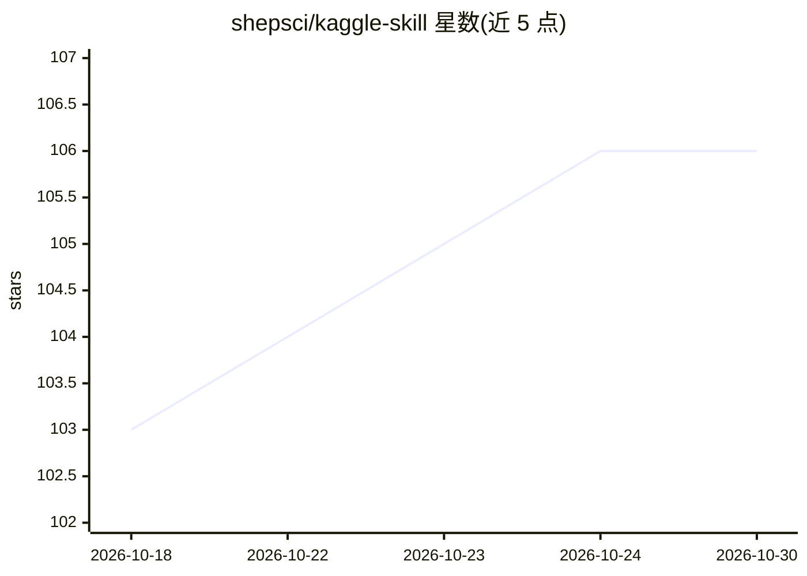

# shepsci/kaggle-skill

⭐ 106 · Python · MIT · 推送 2026-10-15 · [GitHub](https://github.com/shepsci/kaggle-skill) · [官网](https://github.com/shepsci/kaggle-skill) · 个人维护

**给 AI 编程 agent 用的 Kaggle 集成技能/插件**

面向 Claude Code、Codex 等可加载 SKILL.md 包的编码 agent 的独立 Kaggle 技能与插件：以自然语言查询比赛信息、奖金、指标、获奖方案与讨论，读取个人排名/提交额度，下载比赛数据与数据集，检查提交文件，推送/运行 notebook，提交前先干跑并需用户确认。通过 Kaggle CLI 与 kagglehub 库调用 Kaggle，可接入 Kaggle 官方 MCP 服务器的 71 个远程工具。声明与 Kaggle/Google 无隶属关系；读写操作有白名单与环境变量只读开关，不做沙箱。

## 筛选速览

| 维度 | 判定 | 备注 |
|---|---|---|
| AI 角色 | `ai-ecosystem` | LLM/agent 周边工具 |
| 许可风险 | `permissive` | MIT |
| 部署形态 | `library` | 以包/库形式分发 |
| 模型依赖 | — | README 未给出锁定关系 |
| 硬件要求 | — | 无带数字的原话,不猜 |
| 安装摩擦 | `low` | 无编译、无系统依赖或容器化 |
| 成熟度 | — | 结构信号不足 |

## 能力要点

- 提交/notebook/发布等写操作默认干跑，需用户确认后执行
- KAGGLE_SKILL_READ_ONLY / HIDE_ACCOUNT 环境变量控制只读与隐私
- Kaggle 文本标记为数据以降低隐藏指令注入风险
- 支持 Claude Code、Codex、skills.sh（35+ agent）与 OpenClaw 多渠道安装

## 适用场景

- 用对话让编码 agent 查比赛奖金、指标与获奖方案
- 跟踪自己在 Kaggle 的排名、提交额度与 GPU 时数
- 让 agent 检查并代提交比赛文件（先干跑确认）
- 下载比赛数据、推送 notebook 并等待运行结果

## 场景标签

`编码 Agent` · 领域:编码与开发

## 证据(README 行号)

> L12: An independent, unofficial skill and plugin named `kaggle`, for Claude Code,
> L13: Codex and other agents that load `SKILL.md` packages. Not affiliated with,
> L98: |The skill|`SKILL.md` and Python commands under `skills/kaggle/`|The Kaggle credential on your machine|

## 星数曲线

2026-10-18 103 → 2026-10-30 106（+3）

---
*卡片 v1 · prompt 1.4 · 生成 2026-10-23 · 置信度 mid · 依据 README sha `a60b28d8af87` · [字段定义](../../DATASET.md)*
