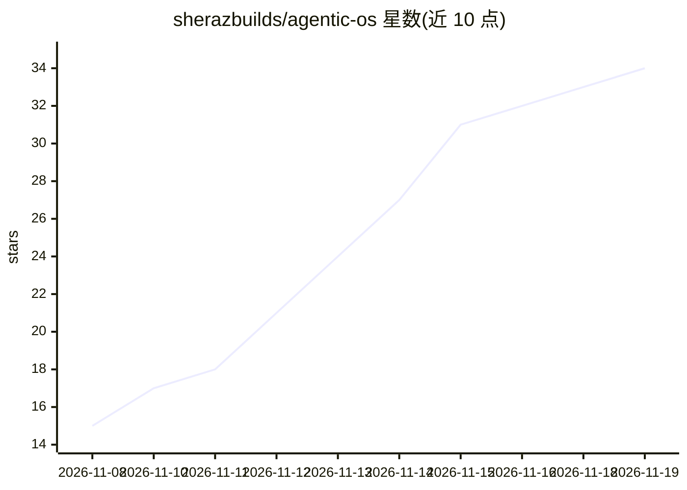

# sherazbuilds/agentic-os

⭐ 34 · GPL-3.0 · 推送 2026-07-18 · [GitHub](https://github.com/sherazbuilds/agentic-os) · [官网](https://agentiqueos.com) · 个人维护

**面向 AI agent 的专用操作系统项目（未发布，候补名单阶段）**

宣称从内核层开始为运行 AI agent 设计的开源操作系统：提供直接 GPU 调度、沙箱内离线 LLM 服务、OS 级向量数据库、gVisor 式容器隔离与单一可启动镜像。当前仓库尚无可安装产物，处于候补名单/等待邀请阶段，规划时间为私测 Q3 2026、公测 Q4 2026、1.0 于 Q1 2027，许可计划 GPLv3。README 未给出任何构建、安装或运行命令。

## 筛选速览

| 维度 | 判定 | 备注 |
|---|---|---|
| AI 角色 | `ai-ecosystem` | LLM/agent 周边工具 |
| 许可风险 | `viral` | GPL-3.0 |
| 部署形态 | `None` |  |
| 模型依赖 | — | README 未给出锁定关系 |
| 硬件要求 | — | 无带数字的原话,不猜 |
| 安装摩擦 | `low` | 无编译、无系统依赖或容器化 |
| 成熟度 | `idea` | |

## 能力要点

- 宣称 agent 执行管线直连硬件加速器的 GPU 调度
- 沙箱内离线 LLM 服务与 OS 级向量数据库
- 单一可启动镜像，确定性与版本锁定
- 尚处早期：仅候补名单，代码与镜像未开放

## 适用场景

- 关注未来用于运行 AI agent 的专用 OS 基础设施
- 加入候补名单获取私测构建与路线图参与机会

## 场景标签

 · 领域:操作系统/AI 基础设施

## 证据(README 行号)

> L5: **Agentic OS** is a purpose-built, open-source operating system engineered from the kernel up to run AI agents at ha
> L13: - **Direct GPU scheduling** — agent executor pipelines connect straight to hardware accelerators without fighting t
> L14: - **Localized LLM services** — run models fully offline, inside isolated sandboxes, with zero cloud dependency

## 星数曲线

2026-11-08 15 → 2026-11-19 34（+19）

---
*卡片 v1 · prompt 1.4 · 生成 2026-11-18 · 置信度 mid · 依据 README sha `8182581b26b3` · [字段定义](../../DATASET.md)*
