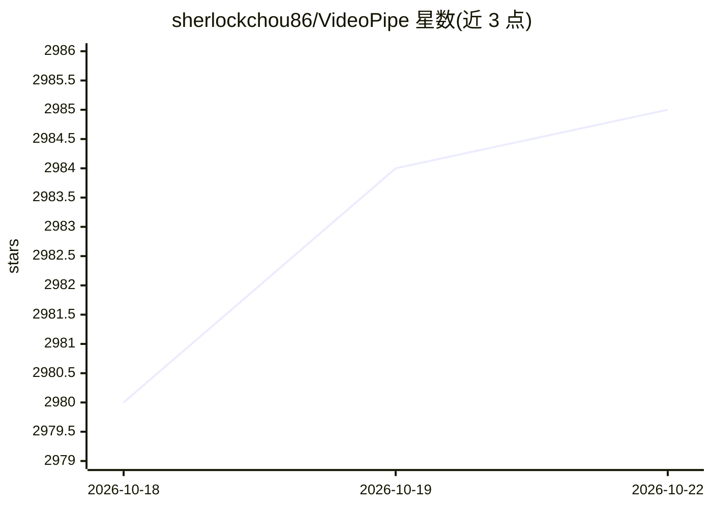

# sherlockchou86/VideoPipe

⭐ 2,985 · C++ · Apache-2.0 · 推送 2026-02-25 · [GitHub](https://github.com/sherlockchou86/VideoPipe) · [官网](http://www.videopipe.cool) · 个人维护 · 中文 README

**C++ 跨平台视频结构化分析框架：用流水线节点组合 CV 模型与 mLLM**

C++ 编写的视频分析与结构化框架，以流水线方式组织独立节点：流读取（RTSP/RTMP/UDP/文件）、编解码、基于深度学习模型的推理（检测/分类/特征提取，支持 mLLM 集成）、目标跟踪、行为分析、数据推送与录屏等。推理后端可选 OpenCV DNN（默认）、TensorRT、Paddle Inference、ONNX Runtime 等，面向交通/安防等场景构建视频分析应用。README 明确其非深度学习框架；与 DeepStream/mxVision 给出功能对比表。需 CMake 从源码编译，系统依赖含 OpenCV>=4.6 与 GStreamer。

## 筛选速览

| 维度 | 判定 | 备注 |
|---|---|---|
| AI 角色 | `ai-native` | 本体是模型或模型工具 |
| 许可风险 | `permissive` | Apache-2.0 |
| 部署形态 | `None` |  |
| 模型依赖 | local-ok | 支持本地模型 |
| 硬件要求 | — | 无带数字的原话,不猜 |
| 安装摩擦 | `high` | 编译与系统依赖俱全 |
| 成熟度 | — | 结构信号不足 |

## 能力要点

- 节点式流水线架构，节点独立可组合
- 推理后端可切换：OpenCV DNN/TensorRT/Paddle/ONNX Runtime，支持 mLLM（Ollama/vLLM/OpenAI 兼容 API）
- 覆盖流读取、跟踪、行为分析、数据推送（Kafka/Socket）、录像、OSD 等完整环节
- 提供 40+ 原型示例（人脸跟踪、车辆跟踪、openpose、mllm 分析等）

## 适用场景

- 交通/安防场景做视频结构化与事件检测（越线、违停等）
- 构建人脸识别、车辆跟踪类视频分析应用
- 把 CV 模型与多模态 LLM 组合进同一条视频分析流水线

## 场景标签

`目标检测` `人脸识别` · 领域:感知与多模态

## 证据(README 行号)

> L9: `VideoPipe` is a framework for video analysis and structuring, written in C++. It has minimal dependencies and is ea
> L37: - **Algorithm Inference**: Supports multi-level inference based on deep learning algorithms, such as object detecti

## 星数曲线

2026-10-18 2,980 → 2026-10-22 2,985（+5）

---
*卡片 v1 · prompt 1.4 · 生成 2026-10-20 · 置信度 high · 依据 README sha `c55866893c81` · [字段定义](../../DATASET.md)*
