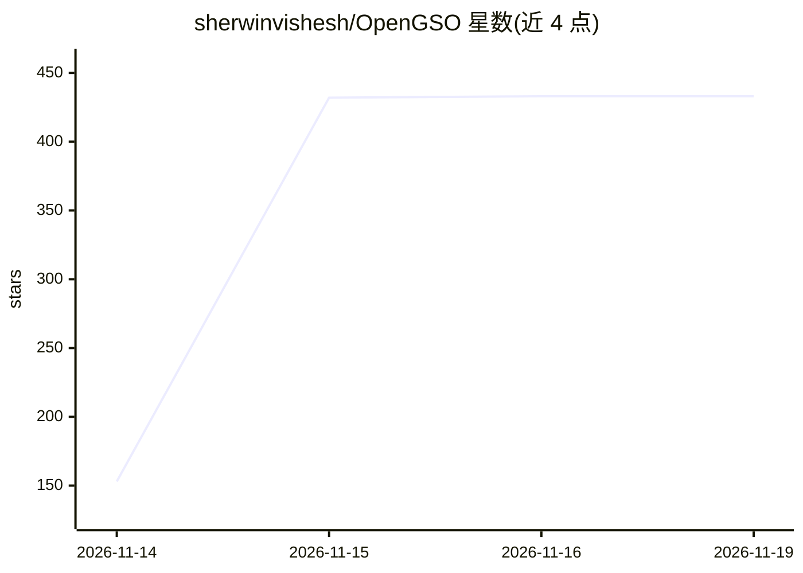

# sherwinvishesh/OpenGSO

⭐ 433 · JavaScript · Apache-2.0 · 推送 2026-11-09 · [GitHub](https://github.com/sherwinvishesh/OpenGSO) · [官网](https://sherwinvishesh.github.io/OpenGSO/) · 个人维护

**让网站对 AI agent 可读的评分与 Markdown 孪生生成工具**

面向网站开发者的 CLI 与 npm 包：test 命令按 22 项检查（7 项计入 0-100 评分，15 项为建议）给站点打分并给出每分理由；generate 命令为每页生成 Markdown 孪生及 robots.txt、llms.txt、sitemap.xml；prod 提供零依赖中间件，在同一 URL 按请求方返回 Markdown 或 HTML，不做重定向。支持 Next.js/Node/fetch/Vite/edge 五种服务器形态，jsdom 仅作解析器不执行脚本。主流程离线运行，仅 generate 的 AI 打磨层级和 --content 需要 AI 提供商的 key（支持 25 个，含本地 ollama/lmstudio）。

## 筛选速览

| 维度 | 判定 | 备注 |
|---|---|---|
| AI 角色 | `ai-ecosystem` | LLM/agent 周边工具 |
| 许可风险 | `permissive` | Apache-2.0 |
| 部署形态 | `library` | 以包/库形式分发 |
| 模型依赖 | local-ok | 支持本地模型 |
| 硬件要求 | — | 无带数字的原话,不猜 |
| 安装摩擦 | `low` | 无编译、无系统依赖或容器化 |
| 成熟度 | `idea` | |

## 能力要点

- test/generate/prod 三命令闭环：打分→生成孪生→部署后验证
- 零依赖中间件在同一 URL 按 Accept/UA 区分 agent 与浏览器，不重定向
- 每页 Markdown 孪生加 robots.txt、llms.txt、sitemap.xml 三个根文件
- 五种服务器形态入口，覆盖 Next.js、Express、Hono、Vite、Cloudflare Workers 等

## 适用场景

- 给自有网站做面向 AI 爬虫的可读性评分与修复
- 为每个页面生成 Markdown 孪生并在同 URL 上服务
- 在 CI 中用 --strict 使未采纳的建议导致失败

## 场景标签

 · 领域:Web 开发/AI 可读性优化

## 证据(README 行号)

> L5: Make your website readable by AI agents: score it, write a markdown twin of every page, and serve
> L24: twin of every page, plus `robots.txt`, `llms.txt` and `sitemap.xml`. **prod** is a zero-dependency
> L93: structural check and all of `opengso-prod` run offline; a key only buys generate's AI polish tier

## 星数曲线

2026-11-14 153 → 2026-11-19 433（+280）

---
*卡片 v1 · prompt 1.4 · 生成 2026-11-17 · 置信度 high · 依据 README sha `87025a5e962b` · [字段定义](../../DATASET.md)*
