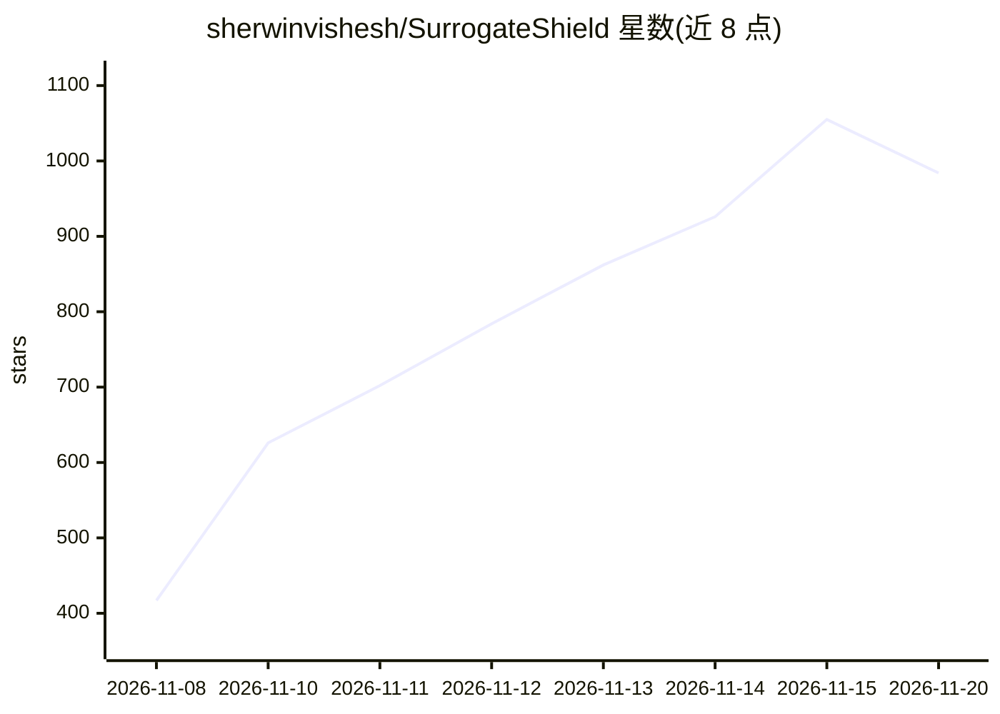

# sherwinvishesh/SurrogateShield

⭐ 984 · Python · Apache-2.0 · 推送 2026-10-16 · [GitHub](https://github.com/sherwinvishesh/SurrogateShield) · [官网](https://sherwinvishesh.github.io/SurrogateShield/) · 个人维护

**LLM/RAG 管道的 PII 防护栏：检测、替换、还原敏感数据**

在消息发送给 LLM 提供商前检测个人数据并替换为格式一致的替身值，收到回复后在本地将真实值还原。检测采用多层流水线：正则结构匹配（带 Luhn/ABA 校验）、DeBERTa PII 标注器、spaCy NER，可选 distilbert-NER，提供 balanced/strict/fast/classic 预设。替身到原文的映射以 AES-256-GCM 加密的 ShadowMap 存储，全部密码学操作在本地执行。支持 Claude、Gemini、ChatGPT 及经 Ollama 离线使用，另含 RAG 文档匿名化与准标识符（k-匿名性）风险提示。以独立 Python 库提供。

## 筛选速览

| 维度 | 判定 | 备注 |
|---|---|---|
| AI 角色 | `ai-ecosystem` | LLM/agent 周边工具 |
| 许可风险 | `permissive` | Apache-2.0 |
| 部署形态 | `library` | 以包/库形式分发 |
| 模型依赖 | local-ok | 支持本地模型 |
| 硬件要求 | — | 无带数字的原话,不猜 |
| 安装摩擦 | `low` | 无编译、无系统依赖或容器化 |
| 成熟度 | — | 结构信号不足 |

## 能力要点

- 多层 PII 检测：正则+DeBERTa 标注器+spaCy，四种预设
- AES-256-GCM 加密 ShadowMap 存储替身映射，密码学操作全部本地运行
- 服务类查询仅做地址轻量偏移以保留回答质量
- 隐私感知 RAG：索引前匿名化文档，向量库操作用替身值

## 适用场景

- 聊天消息送往 LLM 前拦截并替换姓名、证件号、地址等个人信息
- RAG 管道入库前对文档做匿名化处理
- 无需 API 调用即可用 PII Finder 模式测试任意文本的检测效果

## 场景标签

`网络安全` · 领域:学习与行业

## 证据(README 行号)

> L20: SurrogateShield replaces the personal data it detects with realistic, consistent surrogates before your message rea
> L36: - **Multi-provider support**: Claude, Gemini, ChatGPT, or fully offline via Ollama

## 星数曲线

2026-11-08 417 → 2026-11-20 984（+567）

---
*卡片 v1 · prompt 1.4 · 生成 2026-11-17 · 置信度 high · 依据 README sha `35eb54dfac2d` · [字段定义](../../DATASET.md)*
