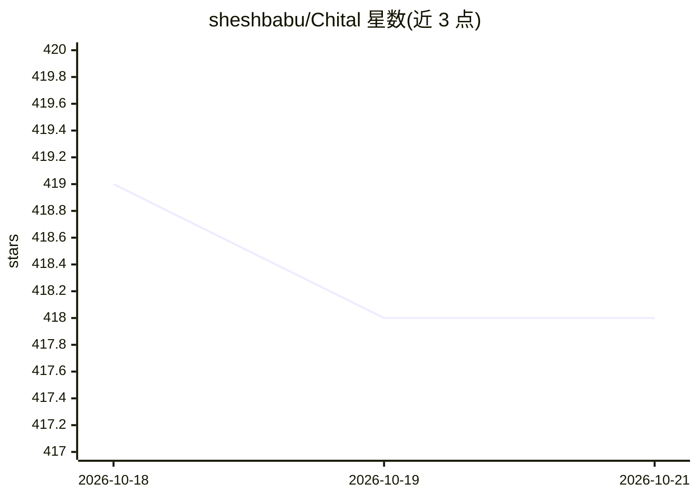

# sheshbabu/Chital

⭐ 417 · Swift · 推送 2026-10-18 · [GitHub](https://github.com/sheshbabu/Chital) · 个人维护

**macOS 原生应用：与本地 Ollama 模型对话**

SwiftUI 编写的 macOS 桌面客户端，连接本地 Ollama 服务进行 LLM 对话：支持多并发会话线程、会话中切换模型、Markdown 渲染、视觉模型的图片附件、推理模型思考等级选择、自动生成会话标题、线程搜索/重命名/分支、导出 Markdown。要求 macOS 14 及以上、已安装 Ollama 并下载至少一个模型。以直接下载 .app 方式安装，作者声明为个人项目，可能不积极维护 PR 与 issue。

## 筛选速览

| 维度 | 判定 | 备注 |
|---|---|---|
| AI 角色 | `ai-native` | 本体是模型或模型工具 |
| 许可风险 | `none` | — |
| 部署形态 | `None` |  |
| 模型依赖 | local-ok | 支持本地模型 |
| 硬件要求 | — | 无带数字的原话,不猜 |
| 安装摩擦 | `low` | 无编译、无系统依赖或容器化 |
| 成熟度 | — | 结构信号不足 |

## 能力要点

- 多并发会话线程与会话中切换模型
- 视觉模型图片附件（Command+V 粘贴）与思考模型支持
- 自动生成会话标题、线程分支与 Markdown 导出

## 适用场景

- 在 macOS 上与本地 Ollama 模型聊天
- 管理多条对话线程并随时切换不同本地模型
- 给视觉/推理模型发送图片并查看推理过程

## 场景标签

 · 领域:LLM 客户端/桌面应用

## 证据(README 行号)

> L2:  A native macOS app for chatting with Ollama models
> L10: * Image attachments for vision models
> L11: * Reasoning display and thinking level picker for thinking models

## 星数曲线

2026-10-18 419 → 2026-10-21 418（-1）

---
*卡片 v1 · prompt 1.4 · 生成 2026-10-22 · 置信度 high · 依据 README sha `989f85c5ac57` · [字段定义](../../DATASET.md)*
