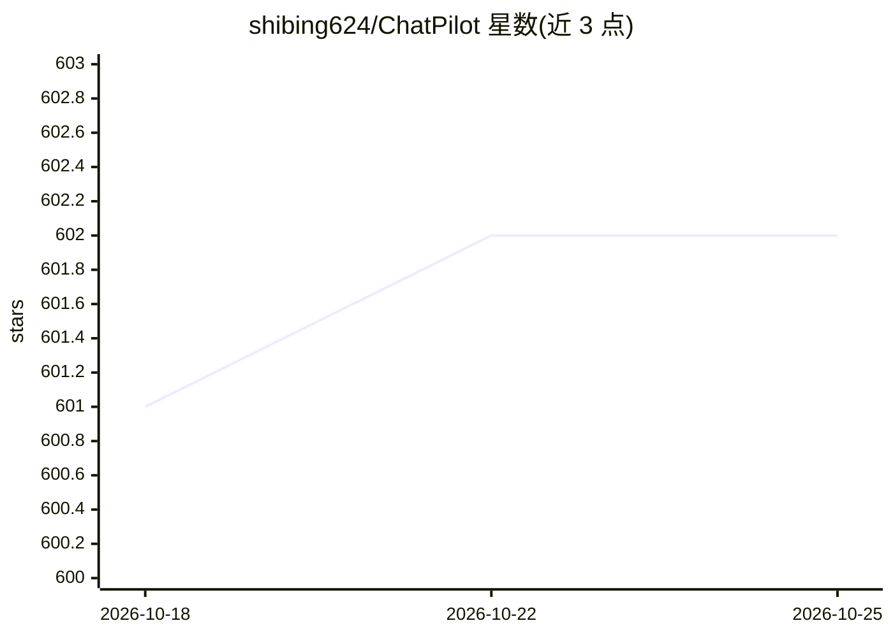

# shibing624/ChatPilot

⭐ 602 · Svelte · Apache-2.0 · 推送 2026-01-27 · [GitHub](https://github.com/shibing624/ChatPilot) · [官网](https://chat.mulanai.com) · 个人维护 · 中文 README

**Chat Agent Web UI：支持搜索/RAG/代码解释器的对话前端**

基于 Agentica 框架实现的 Chat Agent Web 应用：前端 Svelte、后端 FastAPI，前后端分离部署。Agent 可调用外部工具，包括 Google 搜索（Serper/DuckDuckGo）、URL 自动解析、Python 代码解释器（E2B 虚拟环境或本地环境）、RAG 文件问答，并支持语音输入输出与图像生成。LLM 接入支持 OpenAI/Azure API、Ollama 本地模型及 litellm 云服务模型。复现了 Kimi Chat 的文件与网址对话功能。提供 Docker 与源码两种启动方式，含用户管理与权限控制。

## 筛选速览

| 维度 | 判定 | 备注 |
|---|---|---|
| AI 角色 | `ai-native` | 本体是模型或模型工具 |
| 许可风险 | `permissive` | Apache-2.0 |
| 部署形态 | `library` | 以包/库形式分发 |
| 模型依赖 | local-ok | 支持本地模型 |
| 硬件要求 | — | 无带数字的原话,不猜 |
| 安装摩擦 | `low` | 无编译、无系统依赖或容器化 |
| 成熟度 | `idea` | |

## 能力要点

- Agent 工具调用：Google 搜索、URL 解析、RAG 文件问答
- Python 代码解释器（E2B 虚拟环境/本地环境）
- 多种 LLM 接入：OpenAI/Azure API、Ollama、litellm
- Svelte 前端 + FastAPI 后端，支持用户管理与权限控制

## 适用场景

- 搭建支持联网搜索与 RAG 文件问答的对话 Web 应用
- 通过对话让 Agent 调用工具并运行 Python 代码
- 接入本地 Ollama 模型部署私有对话前端

## 场景标签

`聊天机器人` `文档问答` `图像生成` · 领域:对话与助手

## 证据(README 行号)

> L16: **ChatPilot**: Chat Agent WebUI, 实现了AgentChat对话，支持Google搜索、文件网址对话（RAG）、代码解释器功能，复现Kimi Chat(文件，拖进来；网址，发出来)，支持OpenAI/
> L20: - 本项目基于Agentica实现了Agent Assistant调用，支持如下功能：
> L25:  - 多种LLM接入：支持多种LLM模型以多方式接入，包括使用Ollama Api接入各种本地开源模型；使用litellm Api接入各云服务部署模型；使用OpenAI Api接入GPT系列模型

## 星数曲线

2026-10-18 601 → 2026-10-25 602（+1）

---
*卡片 v1 · prompt 1.4 · 生成 2026-10-21 · 置信度 mid · 依据 README sha `8e8c563a54b1` · [字段定义](../../DATASET.md)*
