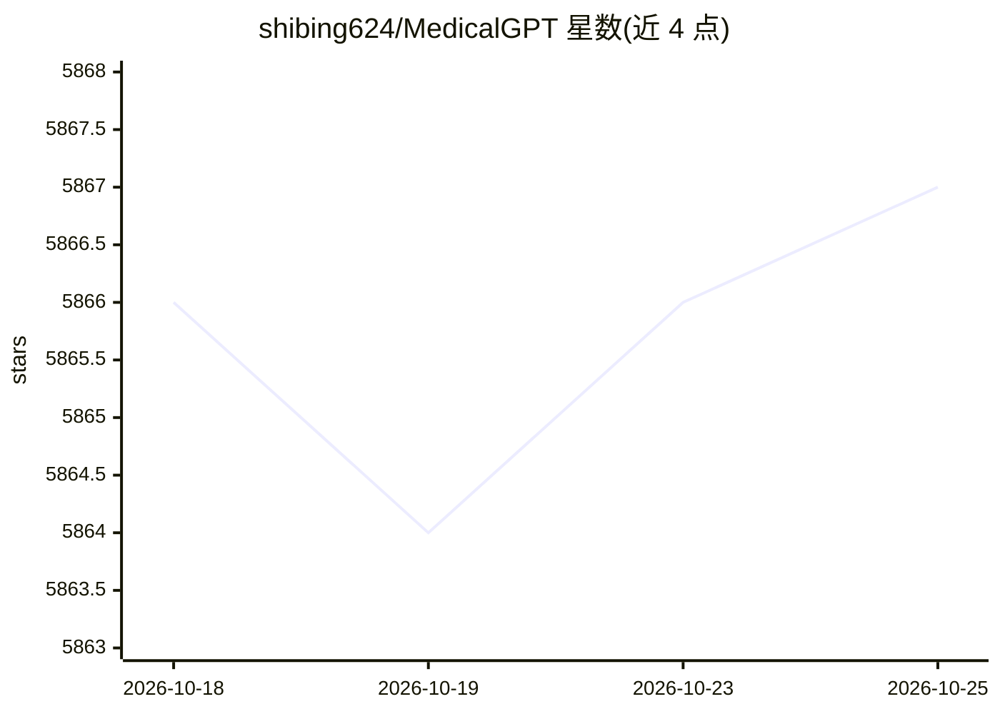

# shibing624/MedicalGPT

⭐ 5,872 · Python · Apache-2.0 · 推送 2026-09-15 · [GitHub](https://github.com/shibing624/MedicalGPT) · 个人维护 · 中文 README

**医疗大模型训练框架：复现 ChatGPT 四阶段训练全流程**

以医疗领域为示例的 LLM 训练代码库，实现增量预训练(PT)、有监督微调(SFT)、奖励建模(RM)、PPO 强化学习、DPO、ORPO、GRPO 与独立 OPD(On-Policy Distillation) 全流程，各阶段提供 Python 训练脚本与 shell 一键脚本，支持 LoRA/QLoRA/全参训练。支持 Qwen、LLaMA、Baichuan、ChatGLM、Mistral、DeepSeek 等 20 余系列模型，支持 Agent 工具调用(Function Call)微调，并提供 Gradio 演示、RAG 问答 ChatPDF、LoRA 合并/量化等工具与 Colab 端到端教程。训练对显存有要求，QLoRA 4bit 7B 约需 6GB。

## 筛选速览

| 维度 | 判定 | 备注 |
|---|---|---|
| AI 角色 | `ai-ecosystem` | LLM/agent 周边工具 |
| 许可风险 | `permissive` | Apache-2.0 |
| 部署形态 | `library` | 以包/库形式分发 |
| 模型依赖 | — | README 未给出锁定关系 |
| 硬件要求 | — | 无带数字的原话,不猜 |
| 安装摩擦 | `low` | 无编译、无系统依赖或容器化 |
| 成熟度 | — | 结构信号不足 |

## 能力要点

- PT/SFT/RM/PPO/DPO/ORPO/GRPO/OPD 八种训练阶段完整实现，附 shell 一键脚本
- Agent 工具调用微调，支持 default/qwen/glm4/llama3/mistral 五种 tool_format
- 支持 Qwen3.5、LLaMA3、Mixtral MoE 等 20+ 系列模型，DeepSpeed ZeRO-3 MoE 训练
- 提供 Gradio 演示、RAG 文件问答(chatpdf.py)、LoRA 合并与 Colab 端到端教程

## 适用场景

- 我需要在医疗领域数据上做增量预训练和指令微调，训练自己的领域大模型
- 我想用 DPO/ORPO/GRPO 对已有模型做偏好对齐训练
- 我想微调一个支持工具调用(Function Call)的 Agent 模型
- 我想用 Colab 快速跑通 PT+SFT+RLHF 全流程

## 场景标签

`微调` `模型训练` `强化学习` · 领域:训练与推理

## 证据(README 行号)

> L18: **MedicalGPT** training medical GPT model with ChatGPT training pipeline, implemantation of Pretraining,
> L19: Supervised Finetuning, RLHF(Reward Modeling and Reinforcement Learning), DPO(Direct Preference Optimization)
> L148: |`training/`|核心训练代码，覆盖PT→SFT→RM→PPO/DPO/ORPO/GRPO全流程|训练模型|

## 星数曲线

2026-10-18 5,866 → 2026-10-25 5,867（+1）

---
*卡片 v1 · prompt 1.4 · 生成 2026-10-20 · 置信度 mid · 依据 README sha `4f6b52217e0e` · [字段定义](../../DATASET.md)*
