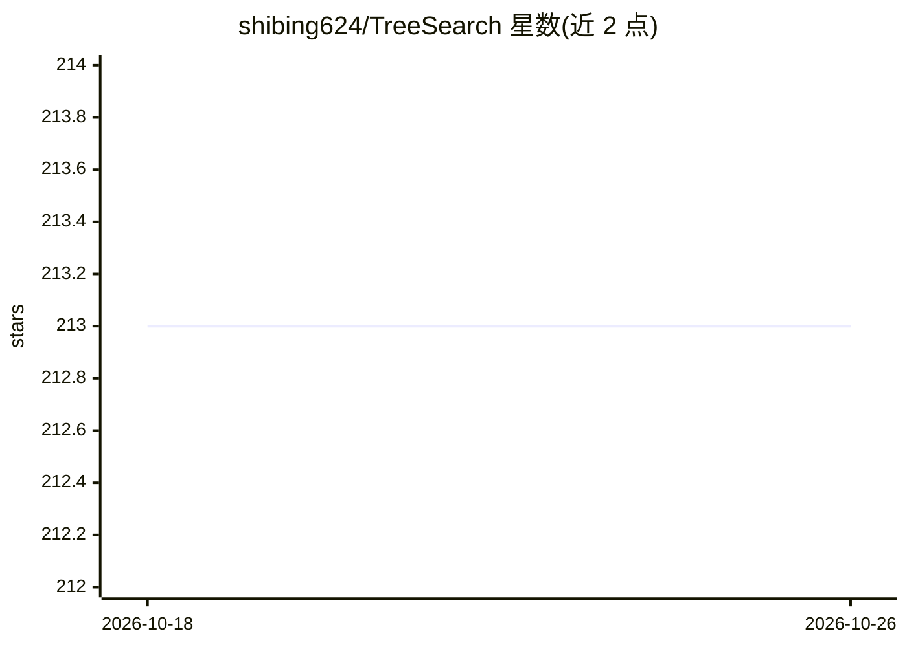

# shibing624/TreeSearch

⭐ 213 · Python · Apache-2.0 · 推送 2026-04-29 · [GitHub](https://github.com/shibing624/TreeSearch) · [官网](https://pypi.org/project/pytreesearch/) · 个人维护 · 中文 README

**结构感知文档检索库：免 embedding 用 FTS5 树结构检索代码库与文档**

面向开发者的检索库：把 Markdown、代码（Python AST+regex，Java/Go/JS/C++ 等）、HTML/XML/JSON/CSV/PDF/DOCX 解析为按标题层级组织的树结构，用 SQLite FTS5 关键词匹配检索，不使用向量 embedding、切分与向量数据库，无需 API key。提供 flat 与 tree 两种模式及 auto 自动选择（依据文档类型与树深度比例阈值），代码文件自动路由到 GrepFilter+FTS5。内建 jieba 中文分词与英文正则分词。以 Python 库/CLI（pip）与 Rust CLI（brew/cargo/预编译二进制）分发。

## 筛选速览

| 维度 | 判定 | 备注 |
|---|---|---|
| AI 角色 | `ai-ecosystem` | LLM/agent 周边工具 |
| 许可风险 | `permissive` | Apache-2.0 |
| 部署形态 | `library` | 以包/库形式分发 |
| 模型依赖 | — | README 未给出锁定关系 |
| 硬件要求 | — | 无带数字的原话,不猜 |
| 安装摩擦 | `low` | 无编译、无系统依赖或容器化 |
| 成熟度 | — | 结构信号不足 |

## 能力要点

- 文档树结构解析 + SQLite FTS5 关键词检索，无 embedding、无向量库、无 API key
- auto 模式按文档类型与树深度阈值自动选择 tree/flat 检索
- 代码文件自动路由 GrepFilter+FTS5，Python AST 提取类/函数签名
- 中英双语文持：jieba 中文分词 + 英文正则分词

## 适用场景

- 在大量技术文档（API 文档/RFC）中按章节层级检索完整段落
- 大型代码库中检索登录/认证相关的类与方法并定位行号
- 长论文按章节问答式定位内容

## 场景标签

 · 领域:信息检索/开发工具

## 证据(README 行号)

> L15: **TreeSearch** is a structure-aware document retrieval library. No vector embeddings. No chunk splitting. SQLite FT
> L190: |**Retrieval**|Vector similarity search|FTS5 keyword matching (no LLM needed)|

## 星数曲线

2026-10-18 213 → 2026-10-26 213（+0）

---
*卡片 v1 · prompt 1.4 · 生成 2026-10-22 · 置信度 high · 依据 README sha `5a572e8223a5` · [字段定义](../../DATASET.md)*
