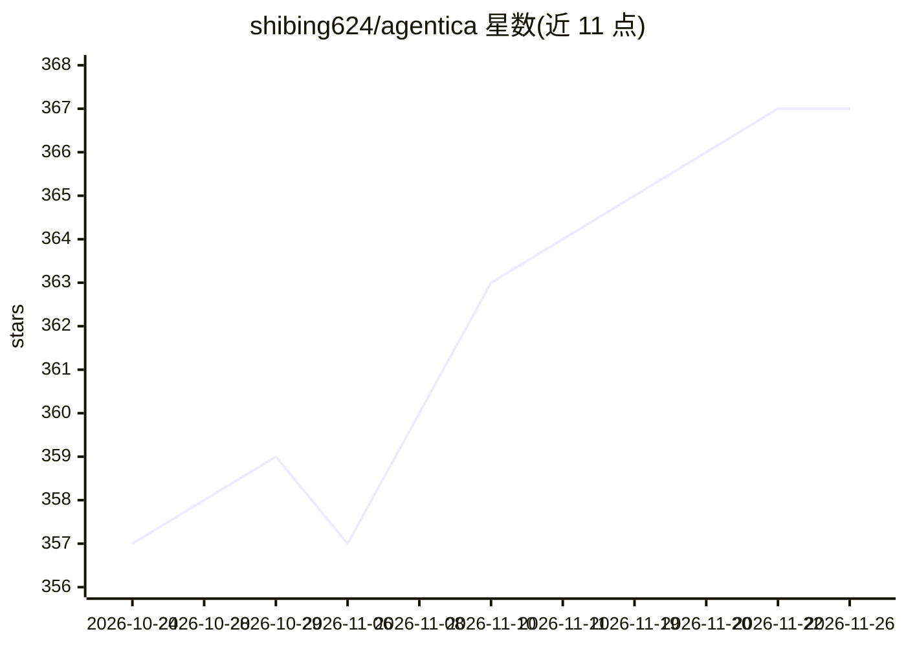

# shibing624/agentica

⭐ 367 · Python · Apache-2.0 · 推送 2026-11-25 · [GitHub](https://github.com/shibing624/agentica) · [官网](https://shibing624.github.io/agentica/) · 个人维护 · 中文 README

**面向个人开发者的多终端 AI Agent 工作台与框架**

以本机为运行环境的 Agent 框架与工作台，提供桌面端、CLI、本地 Web、IM 接入四种使用形态，并发布 Python 与 TypeScript SDK 供二次开发。核心机制包括子任务派生与后台进程管理、worktree 分支隔离、长期记忆与经验沉淀为 Skill、上下文压缩与换窗交接；模型侧宣称对多家厂商模型深度适配并支持会话内切换。安装途径覆盖桌面安装包下载、PyPI 与 npm 包及 Docker 部署。数据与记忆保存在本地。

## 筛选速览

| 维度 | 判定 | 备注 |
|---|---|---|
| AI 角色 | `ai-ecosystem` | LLM/agent 周边工具 |
| 许可风险 | `permissive` | Apache-2.0 |
| 部署形态 | `library` | 以包/库形式分发 |
| 模型依赖 | local-ok | 支持本地模型 |
| 硬件要求 | — | 无带数字的原话,不猜 |
| 安装摩擦 | `low` | 无编译、无系统依赖或容器化 |
| 成熟度 | — | 结构信号不足 |

## 能力要点

- 桌面端 / CLI / 本地 Web / 微信等 IM 四类接入形态，共享同一套本地记忆与技能
- 子任务派生（run_id/child_session_id）与后台命令、worktree 分支隔离
- 长期记忆与经验沉淀为可复用 Skill，带 skill 准入机制
- 提供 Python SDK（agentica）与 npm SDK（@agentica-ai/sdk）

## 适用场景

- 在终端里写代码、查 Bug 并并行开多个会话
- 出门时用微信/飞书在手机上查看并指挥电脑里的任务
- 把 Agent 嵌入自己的 Python 或 Node 服务
- 让 Agent 沉淀项目经验形成可复用技能流程

## 场景标签

`Agent 框架` `Agent 记忆` · 领域:Agent 开发

## 证据(README 行号)

> L33: |**🐍 Python SDK & 📦 npm SDK**|把 Agent 嵌入你自己的 Python 服务或 Node / TypeScript 应用|Python 5 分钟上手 · TypeScript SDK (`@agen
> L53: 一个窗口不够用时，Agent 可以派生只读子任务查代码查资料；`task` 返回 `run_id` / `child_session_id` / `transcript_path` 和工具输出定位符，后续用 `get_task_r
> L57: 你的习惯与项目背景会自动记进长期记忆；踩过的坑和跑通的流程能沉淀为可复用的技能（Skill）。下次遇到同类任务直接按老规矩办，不用每次从头交代。详见 记忆系统 与 Skills。
> L119: 软件本身。同一套 agent harness，既是本机工作台（Desktop、CLI、Web、IM），也是可嵌入线上服务的 Python 与 TypeScript SDK：

## 星数曲线

2026-10-24 357 → 2026-11-26 367（+10）

---
*卡片 v1 · prompt 1.4 · 生成 2026-11-25 · 置信度 high · 依据 README sha `218059786be9` · [字段定义](../../DATASET.md)*
