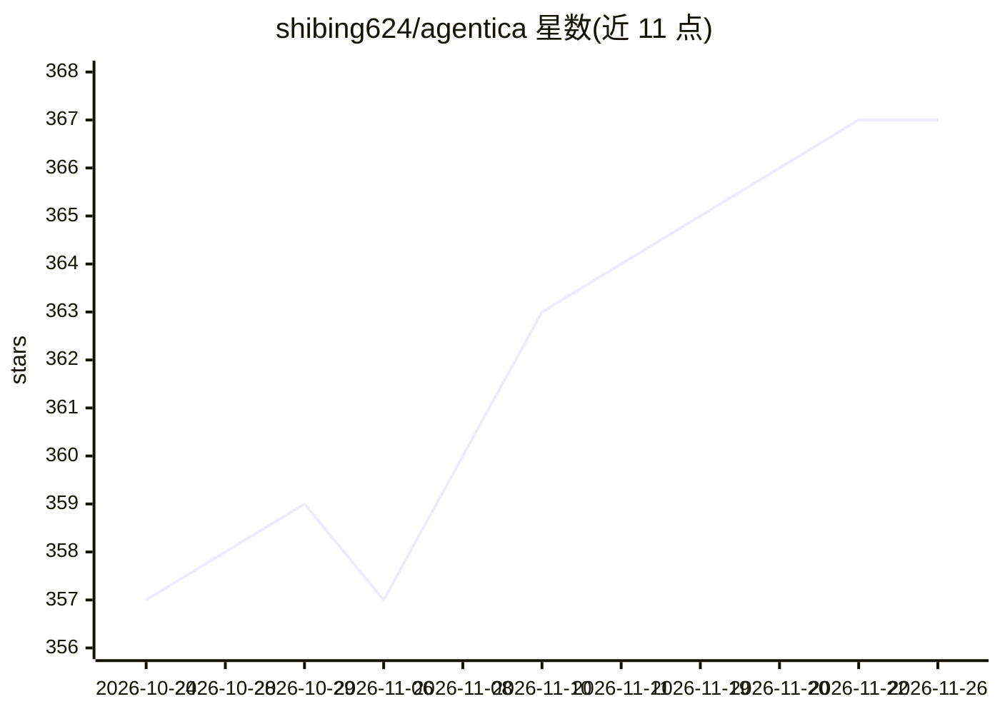

# shibing624/agentica

⭐ 367 · Python · Apache-2.0 · 推送 2026-11-25 · [GitHub](https://github.com/shibing624/agentica) · [官网](https://shibing624.github.io/agentica/) · 个人维护 · 中文 README

**个人可用的多端 AI Agent 工作台与框架**

一个可运行在本机的 AI Agent 工作台与框架，提供桌面端、CLI、本地 Web 与微信/IM 接入，另提供 Python 与 TypeScript SDK 用于二次开发。核心机制包括：子任务派生与后台进程管理、长期记忆沉淀、经验转为可复用 Skill、上下文满窗时的换窗与压缩策略。桌面版覆盖 macOS/Windows/Linux，需配置模型 API Key 或使用本地模型，支持 Docker 部署。项目以 Apache 2.0 协议开源。

## 筛选速览

| 维度 | 判定 | 备注 |
|---|---|---|
| AI 角色 | `ai-ecosystem` | LLM/agent 周边工具 |
| 许可风险 | `permissive` | Apache-2.0 |
| 部署形态 | `library` | 以包/库形式分发 |
| 模型依赖 | — | README 未给出锁定关系 |
| 硬件要求 | — | 无带数字的原话,不猜 |
| 安装摩擦 | `low` | 无编译、无系统依赖或容器化 |
| 成熟度 | — | 结构信号不足 |

## 能力要点

- 同一套本地记忆、技能和会话记录在桌面/CLI/Web/IM 多端接续使用
- 子任务派生（run_id/child_session_id）、后台执行与 Worktree 分支隔离
- 长期记忆自动记录与经验沉淀为 Skill，含 skill 准入机制
- 上下文压缩：换窗线上修剪旧工具结果，支持长任务进度交接

## 适用场景

- 在终端写代码、查 Bug，开多窗口并行处理任务
- 通过微信或 Telegram 远程查看和指挥本机运行中的任务
- 用 Python/npm SDK 把 Agent 嵌入自己的服务或应用
- 让 Agent 记住项目背景，同类任务按沉淀的技能直接执行

## 场景标签

`Agent 框架` `Agent 记忆` `AI 助手` · 领域:Agent 开发

## 证据(README 行号)

> L7:  跑在你自己电脑上的全能 AI 工作台。 桌面端、CLI 终端、本地网页、手机微信随时开干，记忆与技能越用越熟 —— 同时提供 Python & TypeScript SDK。
> L34: |**🐍 Python SDK & 📦 npm SDK**|把 Agent 嵌入你自己的 Python 服务或 Node / TypeScript 应用|Python 5 分钟上手 · TypeScript SDK (`@agen
> L120: 软件本身。同一套 agent harness，既是本机工作台（Desktop、CLI、Web、IM），也是可嵌入线上服务的 Python 与 TypeScript SDK：

## 星数曲线

2026-10-24 357 → 2026-11-26 367（+10）

---
*卡片 v1 · prompt 1.4 · 生成 2026-11-26 · 置信度 high · 依据 README sha `e45371d21323` · [字段定义](../../DATASET.md)*
